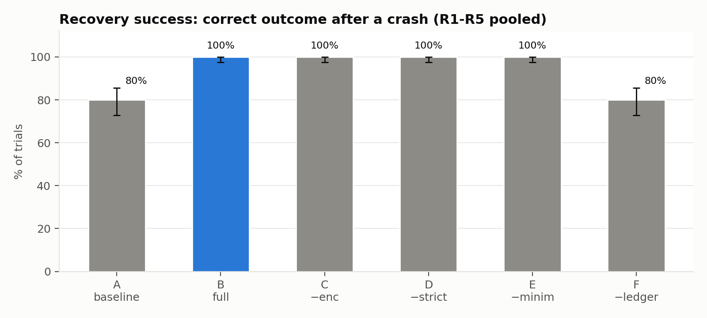
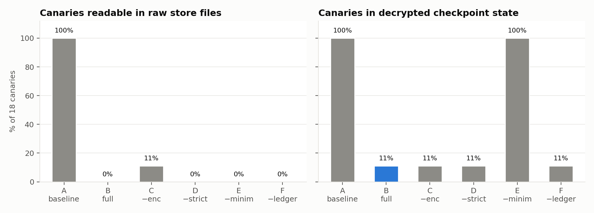
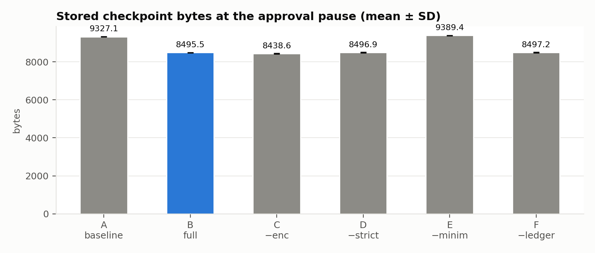
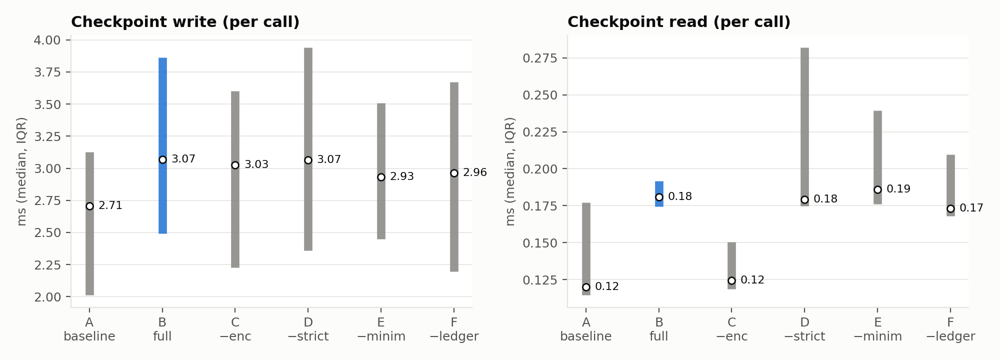
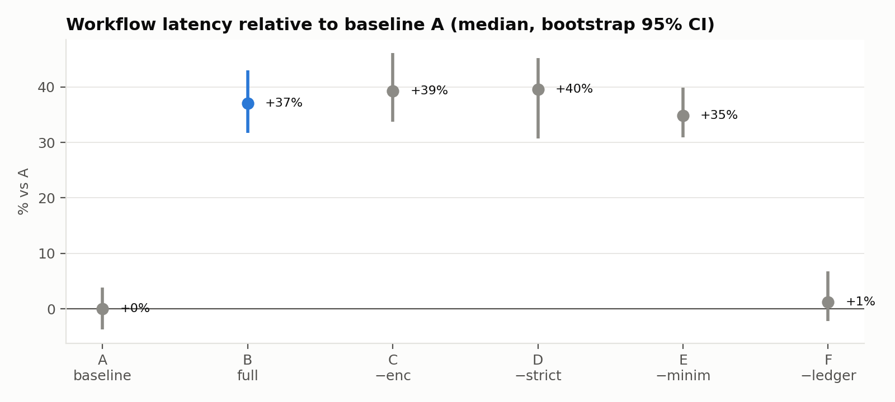
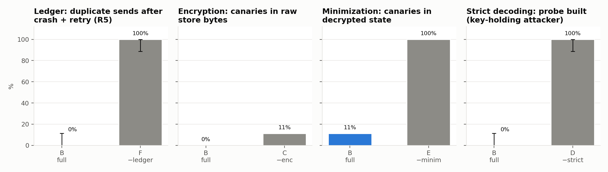

# Secure and privacy-preserving execution persistence: experimental report

**Study status: exploratory.** These results are not confirmatory evidence
under the frozen pre-registration (`preregistration.md`, v1.1, unchanged).

That pre-registration describes:

- five configurations, with the execution ledger always on;
- gating on preconditions PC1 (a pre-send check of the approved-action digest) and PC2 (canonical digest encoding).

This study deviates from it:

- it adds two configurations with the ledger off (A, F);
- it runs without PC1 and PC2, neither of which is implemented.

Run facts:

| Item | Value |
|---|---|
| Run date | 2026-11-09, 03:39–05:17 local |
| Total trials | 5,070 rows in 9 CSV files; 0 failed |
| Machine | Windows 11, Intel 10-core / 12-thread, 16.8 GB |
| Software | Python 3.14.3, SQLite 3.50.4, langgraph 1.2.19, langgraph-checkpoint 4.3.1, langgraph-checkpoint-sqlite 3.1.3, cryptography 42.0.2 |
| Seeds | 20261109 (trials, recovery order), 20261110 (performance order), 20261111 (bootstrap) |
| Raw data | `results/*.csv`, `results/environment.json` |
| Tables | `analysis/output/` (`tables.md` holds every table in full) |
| Figures | `analysis/figures/` |

Methodology, test doubles and the reproduction steps are in [README.md](README.md).

The deployed configuration was not modified, and neither were:

- the frozen models;
- the thresholds;
- the feature configuration;
- the pre-registration;
- the research replay.

All 86 files captured in `snapshots/pre_persistence_eval_20261109/MANIFEST.sha256` still match their hashes after the run.

How to read this report:

- **Demonstrated** means measured in this study, under the stated conditions.
- **Hypothesis** means a plausible explanation that was not separately tested.
- **Observation** means an incidental measured effect that was not the target of an experiment.
- Confidence intervals are 95% Wilson intervals for proportions and 95% bootstrap intervals for medians and ratios.
- With n = 30, an observed 0/30 only bounds the true rate below 11.4%. With n = 150, it bounds it below 2.5%.

---

## A. Experimental configuration table

| ID | Role | Encryption (AES-GCM) | Strict deserialization | State minimization | Execution ledger |
|---|---|---|---|---|---|
| A | baseline (synthetic data only) | OFF | OFF | OFF | OFF |
| B | full PrivAgent | ON | ON | ON | ON |
| C | B without encryption | OFF | ON | ON | ON |
| D | B without strict deserialization | ON | OFF | ON | ON |
| E | B without state minimization | ON | ON | OFF | ON |
| F | B without the execution ledger | ON | ON | ON | OFF |

Held constant in every configuration:

- owner-only file permissions (the same `make_private` call);
- master-key derivation;
- `durability="exit"`;
- completed-thread purge;
- the single flow rule;
- the frozen risk model and thresholds;
- the identical synthetic workload: 5 HR documents and 18 unique canary values per trial.

How each mechanism is switched off is described in [README.md](README.md#configurations). In short:

- the plaintext inner serializer replaces encryption;
- the library's permissive serializer (`allowed_msgpack_modules=True`) replaces strict deserialization;
- a test-only no-op replaces `minimize_state`;
- `NullLedger` replaces the ledger.

**Known coupling.** The approval service derives its signing key from the same master key as the checkpoint cipher. A wrong or missing key therefore also invalidates approval digests in configurations without encryption (see D3).

## B. Quantitative results tables

### B1. Crash recovery (Experiment 1)

Separate OS processes were used, and the pausing process was hard-killed. 30 trials ran per configuration and scenario.

"Correct outcome" means three things:

1. the pending request was recovered intact;
2. the delivery count equals the expected count;
3. a rejected action was never sent.

Results per scenario:

| Scenario | Crash point | Expected deliveries | A | B | C | D | E | F |
|---|---|---|---|---|---|---|---|---|
| R1 | at the pause, then approve (+ second resume) | 1 | 30/30 | 30/30 | 30/30 | 30/30 | 30/30 | 30/30 |
| R2 | at the pause, then reject (+ second resume) | 0 | 30/30 | 30/30 | 30/30 | 30/30 | 30/30 | 30/30 |
| R3 | during review, before approval is recorded | 1 | 30/30 | 30/30 | 30/30 | 30/30 | 30/30 | 30/30 |
| R4 | after approval, before send | 1 | 30/30 | 30/30 | 30/30 | 30/30 | 30/30 | 30/30 |
| R5 | after send, before completion is recorded; then retry | 1 | **0/30** | 30/30 | 30/30 | 30/30 | 30/30 | **0/30** |

Pooled over R1–R5:

| Config | Correct outcome [95% CI] | Pending request recovered | Duplicate delivery [95% CI] | Rejected action sent |
|---|---|---|---|---|
| A | 120/150 = 80.0% [72.9, 85.6] | 150/150 | 30/150 = 20.0% [14.4, 27.1] | 0/30 |
| B | 150/150 = 100% [97.5, 100] | 150/150 | 0/150 [0, 2.5] | 0/30 |
| C | 150/150 = 100% [97.5, 100] | 150/150 | 0/150 [0, 2.5] | 0/30 |
| D | 150/150 = 100% [97.5, 100] | 150/150 | 0/150 [0, 2.5] | 0/30 |
| E | 150/150 = 100% [97.5, 100] | 150/150 | 0/150 [0, 2.5] | 0/30 |
| F | 120/150 = 80.0% [72.9, 85.6] | 150/150 | 30/150 = 20.0% [14.4, 27.1] | 0/30 |

What else happened in these scenarios:

- **A and F failures.** Every failure in A and F is the same event: in R5, the retried approval delivered a second time (2 deliveries in each of the 30 trials).
- **The ledger in R5.** In B–E, the ledger entry for the R5 action stayed in state `executing` (30/30 in each configuration). The approval service approved the retry, and the ledger refused to send.
- **Second resume in R1 and R2.** The helper returned `no_pending_approval` (180/180 per scenario), and a raw resume raised `RuntimeError` (180/180).
- **Recovery latency.** Median end-to-end recovery in a fresh process was 4.3–4.9 s, dominated by app build and imports. Checkpoint reads were 2.3 ms (unencrypted) and 4.9–5.6 ms (encrypted). These were measured with 10 trials running in parallel, so they are indicative only; B6 has the controlled measurements.

### B2. Confidentiality and minimization (Experiment 2)

30 trials per configuration, 18 canaries per trial. The counts are identical in every trial of a configuration, so the SD is 0. The canary classes are:

- 1 requester email;
- 5 document emails;
- 5 API-key-like tokens;
- 5 account numbers;
- 1 analysis marker;
- 1 payload email.

Results:

| Config | Raw bytes at pause (db+WAL+SHM+ledger) | Decrypted state at pause | Raw after completion + purge | Raw after close | State fields holding canaries | Checkpoint rows after purge |
|---|---|---|---|---|---|---|
| A | 18/18 | 18/18 | 18/18 | 18/18 | task, retrieved_documents, analysis, final_output, messages, interrupt_request | 0 |
| B | 0/18 | 2/18 | 0/18 | 0/18 | task, final_output, interrupt_request | 0 |
| C | 2/18 | 2/18 | 2/18 | 2/18 | task, final_output, interrupt_request | 0 |
| D | 0/18 | 2/18 | 0/18 | 0/18 | task, final_output, interrupt_request | 0 |
| E | 0/18 | 18/18 | 0/18 | 0/18 | task, retrieved_documents, analysis, final_output, messages, interrupt_request | 0 |
| F | 0/18 | 2/18 | 0/18 | 0/18 | task, final_output, interrupt_request | 0 |

The 2 canaries retained under minimization are always the requester email (in the task) and the partner email (in the outgoing payload). The reviewer must see both to make the approval decision.

Stored checkpoint blob bytes at the pause (mean ± SD, n = 30):

| A | B | C | D | E | F |
|---|---|---|---|---|---|
| 9,327 ± 13 | 8,496 ± 11 | 8,439 ± 12 | 8,497 ± 14 | 9,389 ± 16 | 8,497 ± 13 |

Database + WAL + SHM file bytes were 86,336 in every trial of every configuration. SQLite allocates whole pages, so file size does not resolve these differences; blob bytes are the size measure.

### B3. Encryption and tamper detection (Experiment 3)

The pause checkpoint was manipulated on disk, then recovered and an approval was attempted. 30 trials per cell.

Each cell shows two things:

- **Recovery:** how the load ended — rejected (with the error raised), or loaded with the state unchanged or altered;
- **Sends:** the number of trials in which the action was delivered afterwards.

| Manipulation | A (no enc) | C (no enc) | B, D, E, F (enc) |
|---|---|---|---|
| none (control) | Recovery: loaded unchanged 30/30. Sends: 30 | Recovery: loaded unchanged 30/30. Sends: 30 | Recovery: loaded unchanged 30/30. Sends: 30 |
| flip one ciphertext/body byte | Recovery: loaded **altered** 30/30. Sends: **30** | Recovery: loaded **altered** 29/30; rejected 1/30 (ValueError). Sends: **29** | Recovery: rejected 30/30 (InvalidTag). Sends: 0 |
| flip last byte (GCM tag) | Recovery: loaded, channel values unchanged, 30/30. Sends: 30 | Recovery: loaded, channel values unchanged, 30/30. Sends: 30 | Recovery: rejected 30/30 (InvalidTag). Sends: 0 |
| truncate 20 bytes | Recovery: rejected 30/30 (ValueError). Sends: 0 | Recovery: rejected 30/30 (ValueError). Sends: 0 | Recovery: rejected 30/30 (InvalidTag). Sends: 0 |
| inject a valid plaintext checkpoint with a changed payload | Recovery: loaded **altered** 30/30. Sends: 0 (approval digest refused) | Recovery: loaded **altered** 30/30. Sends: 0 (approval digest refused) | Recovery: rejected 30/30 (ValueError: plaintext refused). Sends: 0 |
| wrong key | Recovery: loaded unchanged 30/30. Sends: 0 (approval key mismatch) | Recovery: loaded unchanged 30/30. Sends: 0 (approval key mismatch) | Recovery: rejected 30/30 (InvalidTag). Sends: 0 |
| key file deleted | Recovery: loaded unchanged 30/30. Sends: 0 (approval key mismatch) | Recovery: loaded unchanged 30/30. Sends: 0 (approval key mismatch) | Recovery: rejected 30/30 (InvalidTag). Sends: 0 |

Every manipulation is rejected in 30/30 trials, CI [88.6, 100], in each of B, D, E and F.

AES-GCM cost per checkpoint blob (180 trials × 200 repetitions; plaintext about 6.4 KB with minimization, about 7.2 KB without):

| | Encrypt | Decrypt |
|---|---|---|
| Median | 8–17 µs | 7.4–9.2 µs |
| P95 | 23.4–24.0 µs | 21.7–22.9 µs |

### B4. Strict deserialization (Experiment 4)

**Store level.** A probe object was injected into the paused checkpoint and recovered in a separate process. Its only side effect is writing a marker file. 30 trials per row.

| Config | Attacker | Probe constructed [95% CI] | Recovery raised | final_output type |
|---|---|---|---|---|
| A | no key (plaintext blob) | 30/30 [88.6, 100] | 0/30 | SideEffectProbe |
| C | no key (plaintext blob) | 0/30 [0, 11.4] | 0/30 | dict |
| B, D, E, F | no key (plaintext blob) | 0/30 [0, 11.4] each | 30/30 each (plaintext refused) | none |
| B | key holder (validly encrypted) | 0/30 [0, 11.4] | 0/30 | dict |
| D | key holder (validly encrypted) | **30/30** [88.6, 100] | 0/30 | SideEffectProbe |
| E | key holder | 0/30 | 0/30 | dict |
| F | key holder | 0/30 | 0/30 | dict |

**Serializer level.** 30 trials each; a probe-class load runs in a subprocess.

| Case | Permissive | Strict |
|---|---|---|
| importable probe class | constructed 30/30 | not constructed; dict 30/30 |
| class whose module cannot be imported | dict, no error, 30/30 | dict, no error, 30/30 |
| real checkpoint state from each configuration (6 × 30) | round-trip equal 180/180 | round-trip equal 180/180 |
| set, frozenset, bytes, Decimal, datetime, UUID | equal 30/30 each | equal 30/30 each |
| tuple | comes back as list (30/30) | comes back as list (30/30) |
| complex, PurePosixPath | not serializable (30/30) | not serializable (30/30) |

### B5. Execution ledger and duplicate-send prevention (Experiment 5)

Each cell is trials with exactly one delivery (or zero, for a rejection) out of 30, i.e. at most once.

| Scenario | A | B | C | D | E | F |
|---|---|---|---|---|---|---|
| L1 first approval | 30/30 | 30/30 | 30/30 | 30/30 | 30/30 | 30/30 |
| L2 repeated approval (sequential) | 30/30 | 30/30 | 30/30 | 30/30 | 30/30 | 30/30 |
| L3 concurrent double-click (2 threads, barrier) | **5/30** | 30/30 | 30/30 | 30/30 | 30/30 | **0/30** |
| L4 duplicate resume | 30/30 | 30/30 | 30/30 | 30/30 | 30/30 | 30/30 |
| L5 rejection (0 sends expected) | 30/30 | 30/30 | 30/30 | 30/30 | 30/30 | 30/30 |
| R5 crash after send, then retry (from Exp. 1) | **0/30** | 30/30 | 30/30 | 30/30 | 30/30 | **0/30** |

Two more results:

- **Ledger state.** The ledger matched the deliveries in 60/60 checked trials for each of B–E, CI [94.0, 100].
- **Leave-one-out Fisher exact tests (two-sided).** Each is 0/30 against 30/30, p < 10⁻¹⁶:
  - R5 duplicate: B 0/30 vs F 30/30, and B 0/30 vs A 30/30;
  - L3 duplicate: B 0/30 vs F 30/30;
  - key-holder probe constructed: B 0/30 vs D 30/30.

### B6. Performance (Experiment 6)

Runs were sequential, with the configuration order shuffled in each repetition. Per configuration there were 5 warm-ups, excluded, then 40 measured runs, all of which completed. Overhead is the ratio of medians to A, with a bootstrap 95% CI.

| Metric | Config | Mean | Median | SD | P95 | Overhead vs A [95% CI] |
|---|---|---|---|---|---|---|
| Workflow, pause + approve (ms) | A | 36.2 | 35.9 | 2.8 | 41.6 | 0 |
| | B | 49.3 | 49.3 | 3.4 | 55.0 | **+37.1%** [31.7, 43.0] |
| | C | 50.7 | 50.1 | 4.3 | 58.9 | +39.2% [33.8, 46.1] |
| | D | 49.7 | 50.2 | 3.6 | 54.9 | +39.6% [30.7, 45.2] |
| | E | 48.8 | 48.5 | 3.9 | 54.7 | +34.9% [30.9, 39.9] |
| | F | 36.9 | 36.4 | 3.0 | 42.4 | +1.2% [−2.2, 6.7] |
| Run to pause (ms) | A / B / F | 20.1 / 20.9 / 20.8 | 19.9 / 20.7 / 20.1 | 2.2 / 3.2 / 2.8 | 23.9 / 27.0 / 25.6 | B +3.8% [−6.2, 11.4] |
| Approve to completion (ms) | A | 16.1 | 16.3 | 1.4 | 17.9 | 0 |
| | B | 28.4 | 28.1 | 1.7 | 31.2 | +72.6% [67.5, 80.0] |
| | F | 16.0 | 15.7 | 1.9 | 19.5 | −3.5% [−7.1, 2.4] |
| Checkpoint write per call (ms) | A | 2.72 | 2.71 | 0.86 | 4.45 | 0 |
| | B | 3.30 | 3.07 | 0.97 | 5.05 | +13.4% [−3.7, 51.8] |
| Checkpoint read per call (ms) | A | 0.140 | 0.120 | 0.034 | 0.187 | 0 |
| | B | 0.201 | 0.181 | 0.046 | 0.297 | +50.8% [19.3, 56.9] |
| | C (no enc) | 0.140 | 0.124 | 0.031 | 0.192 | +3.6% [−18.6, 8.0] |
| Recovery: store open + build + read (ms) | A | 68.1 | 61.7 | 35.6 | 77.5 | 0 |
| | B | 88.8 | 81.6 | 42.0 | 90.6 | +32.4% [28.2, 38.0] |
| | F | 69.1 | 61.7 | 38.0 | 71.7 | +0.0% [−2.6, 4.0] |
| Stored blob bytes at pause | A | 9,260 | 9,256 | 13 | 9,278 | 0 |
| | B | 8,427 | 8,426 | 17 | 8,446 | −9.0% [−9.1, −8.8] |
| | E (no minim.) | 9,314 | 9,312 | 11 | 9,333 | +0.6% |
| Peak traced Python memory (MB, n = 10) | A / B | 0.316 / 0.318 | 0.315 / 0.317 | 0.002 | none | about +0.6% |

Notes:

- Mann–Whitney U on workflow time, B vs A: U = 1600, p = 1.4 × 10⁻¹⁴. The two distributions are completely separated.
- CPU time per run is reported in `tables.md`, but Windows `process_time` has a resolution of 15.6 ms. On runs of about 100 ms that is too coarse for an interpretable difference, so no conclusion is drawn from it.

## C. Graphs

All graphs follow the same conventions:

- configurations are on the x-axis;
- B is highlighted in blue;
- whiskers are Wilson 95% CIs where a rate is estimated, and are omitted where the measured value is identical in every trial.

**1. Recovery success** (pooled R1–R5). The 20% shortfall in A and F is entirely the R5 duplicate.

**2. Sensitive-data retention.** Left: canaries readable in the raw store files. Right: canaries in decrypted checkpoint state.

**3. Storage size.** Stored checkpoint blob bytes at the approval pause.

**4. Write and read latency.** Per checkpoint call, median and IQR.

**5. Runtime overhead.** Workflow latency relative to A, as the median with a bootstrap CI.

**6. Component ablation.** Each panel compares B with the configuration that lacks one component, on that component's primary outcome.

## D. Research findings

### D1. Crash recovery

**Research question.** Does a paused human-approval action survive a process crash and lead to the correct outcome after restart?

**Evidence.** Experiment 1, table B1, Figure 1.

**Result (demonstrated).**

- The pending approval request was recovered intact in 900/900 trials across all configurations, including at the pause, during review and after approval.
- A rejected action was never sent (0/180 across R2).
- Correct outcomes were 100% [97.5, 100] in B–E, against 80.0% [72.9, 85.6] in A and F.

**Interpretation.**

- Recovering the pending request is a property of LangGraph's SQLite checkpointing. None of the four ablated components influences it.
- The components only matter for what happens after recovery.
- The only crash point that separated the configurations was R5, a crash after the external send but before completion was recorded. There, the retry re-executes the send step unless the ledger refuses it.

**Limitations.**

- Only five fixed crash points, injected with `os._exit`, were tested. Power loss, disk-full and torn writes were not tested.
- With `durability="exit"`, an approval given before a crash at R4 or R5 is not persisted. The reviewer must approve again; this happened in all R4 and R5 trials.
- A crash between the ledger claim and the actual send was not isolated as its own scenario. **Hypothesis:** such a crash would leave the action claimed but never delivered, so it would be lost, not duplicated.
- Recovery latencies were measured under parallel load.

### D2. Confidentiality at rest and state minimization

**Research question.** How much synthetic sensitive data is recoverable from the persisted store, and what does each of encryption and minimization contribute?

**Evidence.** Experiment 2, table B2, Figures 2 and 3.

**Result (demonstrated).**

- **Baseline A.** 18/18 canaries were readable in the raw store bytes at the pause. They were still readable after the run completed and its checkpoint rows were purged (0 rows left), and after the store was closed.
- **Full B.** 0/18 canaries were found by the raw byte scan in any phase. 2/18 remained in the decrypted state: the requester and recipient emails the reviewer needs.
- **Without encryption (C).** The same 2 canaries were readable in plaintext.
- **Without minimization (E).** 0/18 raw, but 18/18 were present in the decrypted state.
- **Storage.** Minimization reduced stored blob bytes by about 9% (A to C: −9.5%). Encryption added about 57 bytes per checkpoint (C to B).

**Interpretation.** The two mechanisms address different exposures:

- **Encryption** governs what an attacker *without the key* can read from the store files, including copies and backups. It does nothing against anyone who holds the key, or against the running process, which sees the decrypted state.
- **Minimization** governs what is persisted at all. That is the only one of the two that reduces exposure to a key holder.

The baseline result is also a positive control for the scan: it shows that purging rows does not remove the bytes from the SQLite file and WAL.

**Limitations.** A string scan returning 0 hits is not proof of confidentiality:

- The scan only detects exact canary strings. Encoded, compressed, split or transformed copies would not be detected.
- Metadata remains visible: thread IDs, action IDs and digests in the ledger, blob sizes, timestamps and row counts.
- Audit logs and application logs outside the store were not part of this scan.
- The 2 retained canaries are retained by design.
- The workload is a single fixed task shape.

### D3. Encryption and tamper detection

**Research question.** Does authenticated encryption detect manipulation of persisted checkpoints, and what happens without it?

**Evidence.** Experiment 3, table B3.

**Result (demonstrated).**

- With encryption (B, D, E, F), all six manipulations were rejected at load in 30/30 trials each, by `InvalidTag` or by the explicit refusal of plaintext blobs. No action was sent after any manipulation.
- Without encryption (A, C), a single flipped body byte was loaded undetected in 59/60 trials, and the approved action was then still delivered in those 59 trials.
- Flipping the last byte changed bytes outside the compared channel values and went undetected in 60/60 trials.
- Truncation was caught by the MsgPack decoder in 60/60 trials.

**Observation.** Without encryption, an injected checkpoint with a *changed outgoing payload* was loaded, but its send was refused in 60/60 trials. The approval service's payload digest caught the change.

- **Implication:** payload integrity against store tampering is provided partly by the approval digest, independently of encryption.
- **Caveat:** that digest protects only the approved payload. Other checkpoint state can be altered undetected without encryption.
- **Not recorded:** whether the flipped byte in the 59 delivered trials lay inside the delivered payload.

**Interpretation.**

- AES-GCM provides integrity and authenticity of each blob against an attacker who does not hold the key.
- **It provides no protection against an attacker who holds the key.** In Experiment 4, a key holder produced validly encrypted malicious blobs that were accepted and decrypted.
- A wrong or missing key makes the paused action unrecoverable. The design fails closed: 0 sends. That is a loss of availability, not data loss without notice.

**Limitations.**

- **The AAD is a constant**, `privagent-checkpoint-v1`. It is not bound to the thread, checkpoint ID or row, so swapping or rolling back to *another validly encrypted* blob was not tested and is not prevented by the cipher.
- The master key is stored in a file in the store directory, protected only by owner-only file permissions. An attacker with the same OS-user access as the application can read both the key and the ciphertext. The protection therefore applies to copies of the database without the key file, not to a compromised user account.
- Without encryption, wrong or missing keys are detected only through the coupled approval key; this is a confound.
- The AES-GCM microbenchmark has visible run-to-run variation between configurations: medians of 8–17 µs for identical work.

### D4. Strict deserialization

**Research question.** Does restricting MsgPack decoding prevent construction of attacker-chosen objects when a checkpoint is loaded, and does the restriction break legitimate state?

**Evidence.** Experiment 4, table B4.

**Result (demonstrated).**

- **Plaintext probe:**
  - permissive decoding (A) constructed the probe object, running its side effect, in 30/30 trials;
  - strict decoding (C) returned a plain dict in 30/30.
- **Key holder:**
  - with permissive decoding (D), the probe was constructed in 30/30 trials;
  - with strict decoding (B, E, F), in 0/30 each.
  - Fisher test, B vs D: p < 10⁻¹⁶.
- **No key, encrypted configurations:** recovery raised before any decoding, so strict deserialization was never reached.
- **Compatibility:** strict decoding round-tripped real checkpoint state from all six configurations in 180/180 trials, and the standard types in 30/30 each, identically to permissive mode.

**Interpretation.**

- Encryption and strict deserialization are complementary layers:
  - encryption stops unauthenticated blobs from reaching the decoder at all;
  - strict decoding is what limits a key holder, or any attacker when encryption is off.
- This is defence in depth from established mechanisms, not a new technique.

**Limitations.**

- The probe is a benign stand-in: an importable dataclass with a constructor side effect. No real gadget chain was tested, and the result does not establish whether permissive mode is exploitable for arbitrary code execution in this deployment. It shows only that permissive mode reconstructs importable classes chosen by the blob.
- **Compatibility risk:** strict mode converts unknown and custom classes to dicts silently, with no error. So does permissive mode for classes it cannot import. Any future state field holding custom objects would change type after a restart without warning.
- Tuples come back as lists in both modes.

### D5. Execution ledger and duplicate-send prevention

**Research question.** Does the execution ledger prevent duplicate external sends, and in which paths is it the deciding mechanism?

**Evidence.** Experiments 5 and 1 (R5), table B5, Figure 6, first panel.

**Result (demonstrated).** With the ledger (B–E), no trial in any scenario delivered more than once. Without it, duplicates occurred in exactly two paths:

| Path | A | F |
|---|---|---|
| crash after send, then retry (R5) | 30/30 trials | 30/30 trials |
| concurrent double-click (L3) | 25/30 trials | 30/30 trials |

In the other paths (L2 sequential repeated approval, L4 duplicate resume, R1/R2 second resume), no configuration produced a duplicate. Other mechanisms already block those paths:

- LangGraph treats a finished thread as a no-op;
- the resume helper refuses when nothing is pending;
- completed threads are purged.

**Interpretation.**

- The ledger is the deciding mechanism only where execution re-enters the send step: a retry after a crash, or a race between two approvals.
- What it provides is **at-most-once execution per action ID, within this single SQLite-backed process model**. It is not exactly-once:
  - after R5, the action was delivered once, but its ledger entry stays `executing`, so the system cannot tell whether that delivery happened;
  - an action claimed but crashed before sending would not be retried (hypothesis, see D1);
  - neither case is resolved without reconciliation with the external recipient.
- The protection covers only the receiving system as observed through the synthetic MCP log. It gives no guarantee about the recipient's behaviour.

**Limitations.**

- **L3 measurement artifact.** In configuration A, 1 trial logged 1 attempt but 2 deliveries. The two threads append to the same log file in-process, and a line was evidently lost. Duplicate counts without a ledger in L3 are therefore a lower bound. The cross-process R5 counts are not affected.
- The double-click test uses two threads in one process. Multiple processes or hosts sharing one ledger were not tested; SQLite permits a single writer at a time.

### D6. Performance overhead

**Research question.** What runtime, storage and memory cost do the four components add, and which component causes it?

**Evidence.** Experiment 6, table B6, Figures 4 and 5.

**Result (demonstrated).**

- **Workflow.** The full configuration B added +37.1% [31.7, 43.0] to the measured workflow (median 49.3 ms against 35.9 ms; Mann–Whitney p = 1.4 × 10⁻¹⁴).
- **Removing one component.** Removing the ledger (F) brought the cost back to the baseline: +1.2% [−2.2, 6.7]. Removing encryption (C), strict decoding (D) or minimization (E) did not measurably reduce it: +34.9% to +39.6%, with overlapping CIs.
- **Where the cost lands:**
  - approve-to-completion: +12.3 ms in every configuration with the ledger, against +0 in A and F;
  - recovery (open + build + read): +20 ms with the ledger.
- **Encryption** raised per-call checkpoint read latency from 0.12 to 0.18 ms. No configuration's write latency differed from A beyond its CI.
- **Memory:** peak traced Python memory differed by less than 1%.

**Interpretation.**

- Nearly all of the measured overhead comes from the ledger.
- **Hypothesis:** the cost is synchronous SQLite commits for claim and finish, plus opening and setting permissions on a second database file. This was not profiled separately.
- In absolute terms the overhead is about 13 ms per approved action.
- **Hypothesis:** in a real deployment, where each LLM call takes seconds and the reviewer takes minutes, this is negligible. LLM and MCP latency were replaced by test doubles and not measured.

**Limitations.**

- One machine, Windows, with the power plan not controlled.
- One payload size (about 6–9 KB of checkpoint state). Scaling with state size was not measured.
- CPU-time resolution is too coarse to interpret.
- The relative overhead is large only because the synthetic baseline workflow is very short.

### What this study does not show

- **No novelty claim.** Each mechanism is established: AEAD encryption, allow-list deserialization, data minimization and an idempotency ledger. The contribution here is a controlled leave-one-out measurement of how they interact in one human-approval agent workflow, not a new technique.
- **The results are not a general security guarantee.** All outcomes come from synthetic data, synthetic MCP and LLM doubles and fixed fault points. Passing these trials is evidence for these conditions only.
- The system is a research prototype and is not described as production-ready.

## E. Limitations

1. **SQLite single writer.** The checkpoint store and the ledger are local SQLite files. Concurrency was tested only as two threads in one process. Multiple worker processes, multiple hosts or network file systems are outside what was tested, and the ledger's at-most-once property depends on SQLite's locking on a local disk.
2. **Key storage and rotation.**
   - The master key lives in a file next to the store, protected only by owner-only permissions. Encryption therefore protects detached copies (backups, a copied database file), not against an attacker with the application's OS account. **Encryption gives no protection against an attacker who also holds the key.**
   - Key rotation is not implemented. A lost or wrong key makes paused actions unrecoverable (fail-closed, D3).
   - The approval-signing key is derived from the same master key, which couples the two mechanisms.
   - The AAD is constant, so rollback or swap between valid ciphertexts is not prevented.
3. **In-memory provenance.** The provenance registry and handoff events are held in memory. After a restart, the recovered run relies on the persisted approval request and digests; provenance cannot be re-evaluated. Provenance sensitivity remains in shadow mode, and its persistence was not evaluated here.
4. **Crashes before the approval checkpoint.** With `durability="exit"`, nothing is persisted before the pause checkpoint, so a crash earlier in the run loses it and requires a full re-run. This was not part of R1–R5. In R4 and R5, the approval decision itself was not persisted and had to be given again.
5. **Strict-deserialization compatibility.** Strict mode currently round-trips all checkpoint state, but it silently converts unknown or custom classes to dicts, and tuples become lists in both modes. Future state schemas carrying custom types could break silently after a restart. That makes this a maintenance constraint, not a measured failure.
6. **Generalizability.** The study used:
   - one synthetic workload (5 HR documents, one flow rule, one outgoing transmission);
   - a scripted LLM and a synthetic in-process MCP server;
   - one machine running Windows 11;
   - one software stack version.

   Real MCP servers, real LLM latency, larger states, other operating systems (file permissions differ) and other LangGraph versions may behave differently.
7. **Threats to validity.**
   - **Internal:**
     - the components are toggled by test-time substitution (`NullLedger`, the permissive serializer, a no-op `minimize_state`), not by deployed configuration;
     - interactions are confounded where mechanisms overlap: encryption shields the decoder, and the shared master key couples encryption with the approval digests;
     - crash-recovery trials ran 10 in parallel;
     - in-process L3 log appends lost a line once.
   - **Construct:**
     - the canary string scan measures exact-string exposure only;
     - the probe object is a proxy for, not an instance of, an exploit;
     - "correct outcome" is judged on the synthetic delivery log, not on recipient state.
   - **Statistical:**
     - n = 30 per cell bounds an observed 0/30 only below 11.4%; rare failures below that rate cannot be excluded;
     - most outcomes are deterministic (0/30 or 30/30), so the CIs reflect sample size, not observed variability.
   - **Pre-registration:** this study departs from pre-registration v1.1 (ledger-off configurations added; PC1 and PC2 not implemented). Its results are exploratory, and a confirmatory run would have to follow the frozen design once PC1 and PC2 exist.
