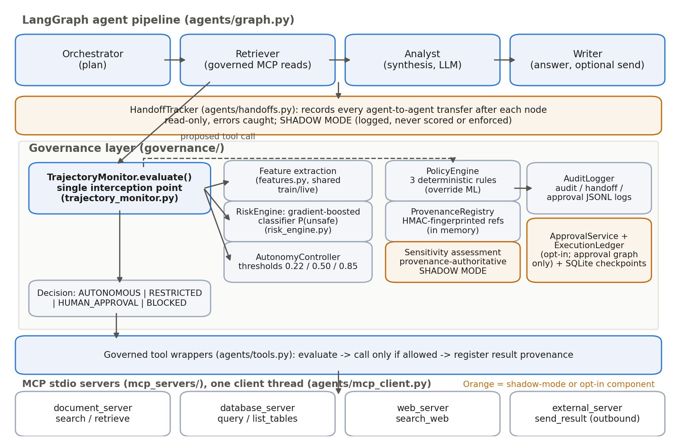
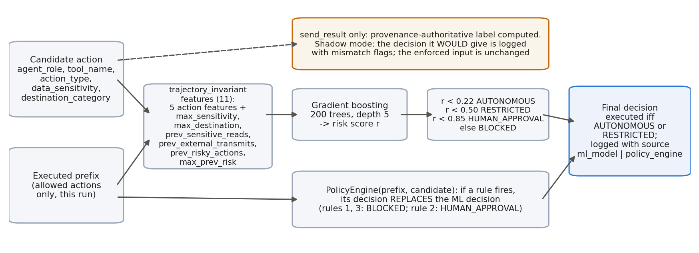
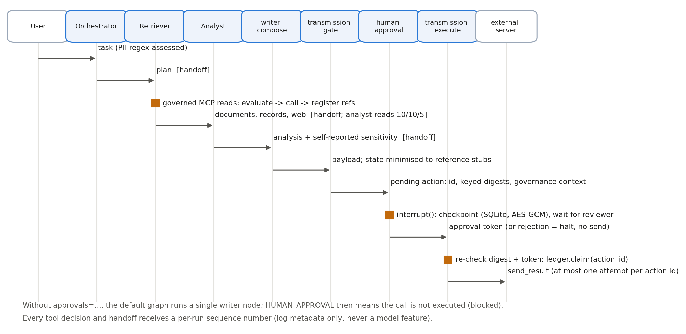
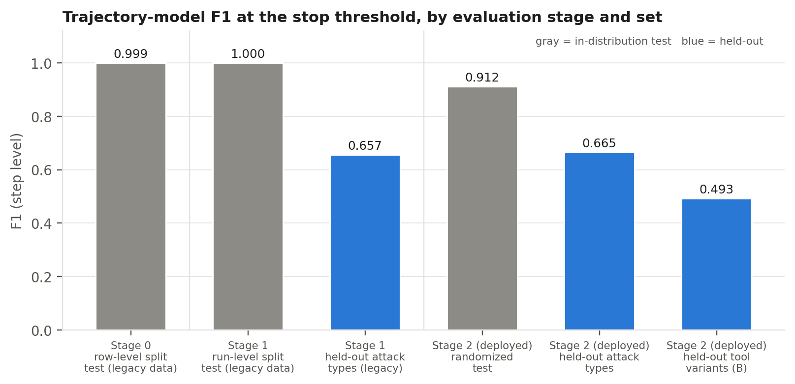
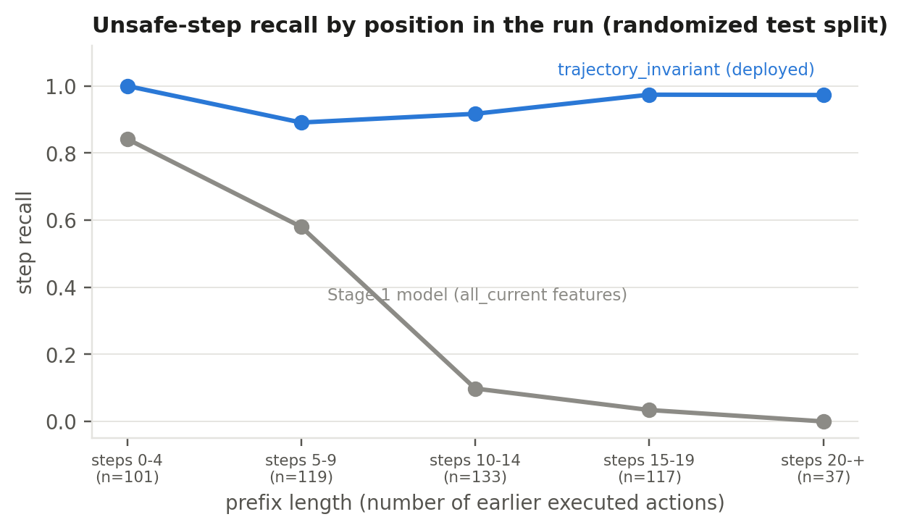
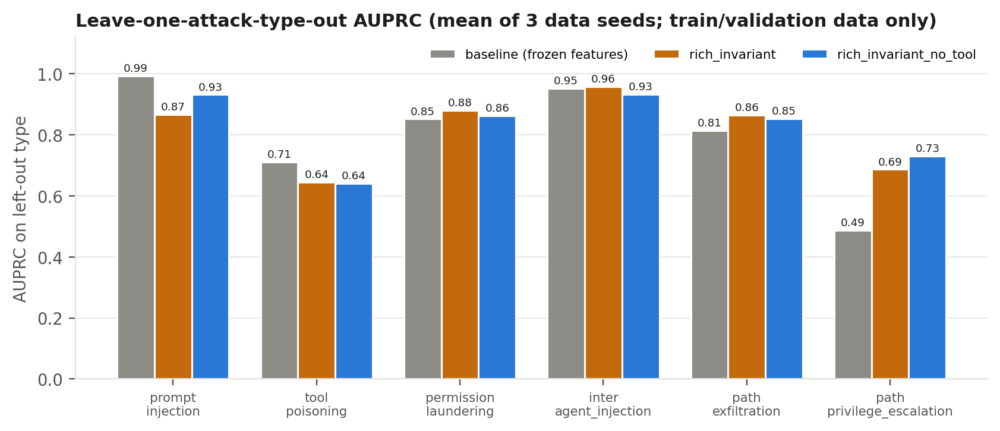
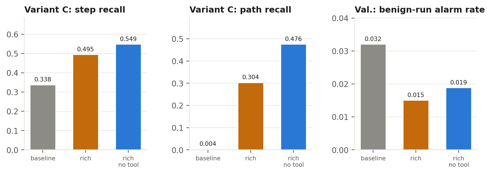
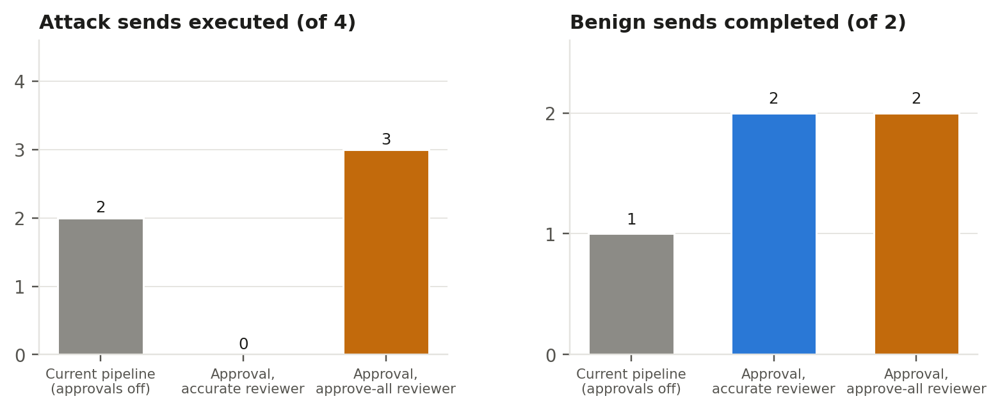
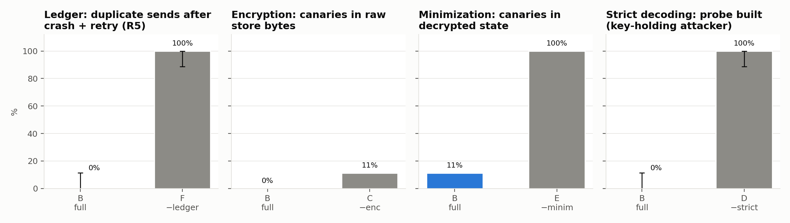

# PrivAgent: Trajectory-Aware Runtime Governance for Multi-Agent LLM Systems

### System Architecture, Shadow-Mode Provenance, and a Leakage-Corrected Empirical Evaluation

*[Author names and affiliations to be added]* · Working research draft, 10 November 2026

---

**Abstract.**

*Problem.* Tool-using LLM agents can disclose sensitive data through a sequence of individually plausible actions. A monitor that judges each tool call in isolation cannot see risk that only appears across the sequence.

*System.* PrivAgent is a runtime governance layer for a four-agent LangGraph pipeline whose tools are served by Model Context Protocol (MCP) servers. Every proposed tool call passes through a single interception point. There, a gradient-boosted classifier scores the call using features of the run's executed prefix, a deterministic policy engine may override the score, and an autonomy controller maps the outcome to one of four modes. Every decision is logged. PrivAgent also adds:

- a provenance registry and agent-to-agent handoff instrumentation, which derive an outbound sensitivity label from the data an agent actually received rather than from what the agent declares, operating in *shadow mode*;
- an opt-in human-approval workflow that pauses an external transmission with LangGraph's `interrupt()` and records each approved action in a persistent execution ledger.

*Evaluation.* Every experiment uses synthetic, template-generated trajectories and scripted test doubles. The originally reported trajectory-model F1 of 0.999 came from a row-level train/test split. After splitting by run, tuning thresholds on validation data only, and scoring held-out attack types, F1 on unseen attack types fell to 0.657. We then found that the model used step position as a shortcut. The deployed position-invariant model (`trajectory_invariant`) gives these results:

| Evaluation set | F1 | Step recall | AUROC |
|---|---|---|---|
| In-distribution test | 0.912 | | |
| Held-out attack types | 0.665 | 0.543 | 0.984 |
| Held-out tool-swapped variants | 0.493 | 0.346 | |

It catches 6 of 107 runs (5.6%) of the held-out path-dependent `path_cross_agent_leak` attack. Flow features improved leave-one-type-out detection of path attacks, but weakened detection of direct attacks. They did not pass a decision rule fixed before the comparison, so the frozen baseline was kept.

In an eight-scenario evaluation of the approval workflow:

- an accurate simulated reviewer allowed 0 of 4 attack transmissions and both legitimate sends;
- a reviewer who approves everything allowed 3 of 4 attack transmissions.

*Contribution.* The contribution is an integrated, inspectable prototype and an honest account of how evaluation leakage and positional shortcuts inflate trajectory-level detection results. It is not a security guarantee. Provenance-based sensitivity is not enforced, the dashboard is not evaluated with human reviewers, and the persistence study is exploratory.

**Index Terms:** LLM agents, multi-agent systems, runtime monitoring, information flow, data provenance, human-in-the-loop, evaluation leakage, shortcut learning.

---

## 1. Introduction

### 1.1 Background

LLM-based agents increasingly act through tools: they retrieve documents, query databases and send messages. Frameworks such as LangGraph compose several specialised agents into a stateful graph [3]. Protocols such as the Model Context Protocol (MCP), introduced by Anthropic in November 2024, standardise how agents reach external tools and data [1], [2].

The attack surface grows with this architecture. Indirect prompt injection showed that instructions planted in retrieved content can redirect an LLM-integrated application [4]. Benchmarks such as InjecAgent [5] and AgentDojo [6] measure how often tool-using agents follow such instructions.

### 1.2 Why per-action monitoring is not enough

Many defences decide whether a single tool call is acceptable. In a multi-agent pipeline, however, a disclosure is often a *trajectory*:

1. one agent reads sensitive records;
2. a second agent summarises them;
3. a third agent transmits the summary externally.

Each step may look legitimate in isolation. Moreover, the agent that finally transmits the data may honestly or dishonestly declare that it contains nothing sensitive.

### 1.3 Research questions

PrivAgent was built to study three questions in a working system:

- **RQ1:** Does conditioning a learned risk score on the run's executed prefix help detect multi-step disclosure patterns, including attack types not seen in training, once the evaluation is free of leakage?
- **RQ2:** Can the sensitivity of outbound data be derived from what an agent actually received (provenance), instead of what the agent declares, without changing agent behaviour?
- **RQ3:** Can a human-approval step be inserted before an external transmission so that the run pauses safely, is bound to the exact reviewed action, and does not execute the action twice?

### 1.4 Contributions

We state the contributions conservatively and separate research findings from engineering work. The research findings are:

- **C1, evaluation correction.** We document how three defects in the original evaluation produced an F1 of 0.999: rows from the same run split across train and test, thresholds tuned on training data, and held-out attacks never scored. We show what remains after correction (Section 6.1, Section 7.1). This is a cautionary case study consistent with the general leakage literature [21]. It is not a new method.
- **C2, position shortcut.** We show that the corrected model's detections depended on where an attack sat in the run, and that a position-invariant feature set removes this dependence by construction. The cost is weaker generalisation to unseen path-dependent attacks (Section 7.2). This is an instance of shortcut learning [22].
- **C3, negative and mixed results for flow features.** Under a decision rule fixed in advance, flow features improved detection of path-dependent attacks and halved validation false alarms, but reduced recall on several direct attack families. The baseline was retained (Section 7.3).

The engineering contributions are:

- **E1, integrated prototype.** A single interception point that combines trajectory ML scoring, deterministic policy rules, audit logging, and real MCP tool servers (Sections 4–5).
- **E2, shadow-mode provenance.** Content-fingerprinted provenance and handoff instrumentation that produce a provenance-authoritative sensitivity label in shadow mode, without changing agent prompts, state or decisions (Section 4.8–4.9).
- **E3, opt-in approval workflow.** It pauses before the external send, binds the review to an action digest, and records each action in an execution ledger that permits at most one execution attempt per action identifier (Section 4.10).

**Novelty.** We do not claim novelty for combining these mechanisms. Recent work already combines provenance, capabilities, policy gates and approvals for agents [7], [8], [10], [11], [13], [14]. Section 2 compares PrivAgent with that work.

---

## 2. Background and Related Work

### 2.1 Attacks on tool-using agents

**Indirect prompt injection.** Greshake et al. characterised indirect prompt injection against LLM-integrated applications, including data theft [4].

**Benchmarks.** InjecAgent benchmarks indirect prompt injection across 1,054 test cases with user and attacker tools [5]. AgentDojo provides an extensible environment of 97 tasks and 629 security test cases for evaluating attacks and defences [6].

**How PrivAgent differs.** PrivAgent's Attack Lab is far smaller. It replays seven scripted attack patterns and does not cause an LLM to be deceived. The dataset therefore tests detection of *action patterns*, not resistance to real injections (Section 8).

### 2.2 Runtime enforcement for agents

**Capability and information-flow designs.**

- **CaMeL** separates control flow derived from the trusted user query from untrusted data. It tracks value provenance in a custom interpreter and enforces capability-based policies [7] (preprint).
- **FIDES** applies information-flow control to agent planners, propagating confidentiality and integrity labels deterministically [8] (preprint).
- **Progent** enforces fine-grained, programmable privilege policies on tool calls [14] (preprint).
- **IsolateGPT** isolates LLM applications in a hub-and-spoke architecture [15] (NDSS 2025).

All four enforce *deterministic* guarantees on data or control flow. PrivAgent's core decision, by contrast, is a *learned* risk score over a trajectory, with deterministic rules as an override. Its provenance mechanism is observational (shadow mode) and is not an enforced information-flow policy.

### 2.3 Trajectory-level and provenance-based monitoring

Several recent preprints address the compositional risk PrivAgent targets, with deterministic mechanisms:

- **AGATE.** A runtime gate that checks authorisation together with data provenance from registered sources to later transfers. It includes parameter-bound, expiring grants and an *effect ledger* [10] (arXiv, September 2026, preprint). AGATE is the closest work we found. Its provenance and ledger concepts overlap substantially with PrivAgent's provenance registry and execution ledger. AGATE enforces its checks deterministically and is evaluated across three production agent harnesses. PrivAgent's provenance is shadow-mode only and is evaluated on a single synthetic pipeline.
- **Agent-Sentry.** Bounds agents through execution provenance [16] (preprint).
- **Agent-BOM.** Represents an agent system as a hierarchical attributed graph that links static capabilities to runtime states for path-level security auditing [12] (preprint). PrivAgent's handoff log is a much narrower, per-run record of agent-to-agent transfers. It contains no static capability model.

**The analogy to information-flow control.** PrivAgent's sensitivity combination rule is a two-level instance of lattice-based flow labelling [17]: any sensitive input makes the output sensitive. An unknown label is treated as sensitive. The rule sits within the classical data-provenance tradition [18].

**Label explosion.** Taint propagation of this kind over-approximates: an output is labelled with every input the agent could have used. *Permissive Information-Flow Analysis for LLMs* addresses exactly this, propagating labels only from inputs that influenced the output [9]. The preprint is listed by Microsoft Research as published in TMLR; we did not confirm the venue on OpenReview. PrivAgent has the over-labelling problem and does not address it (Section 8).

### 2.4 Policy-based governance and approval

**Capability-token approaches.**

- **CapAgent** maps human-attested task intent to capability tokens checked by a reference monitor, as described in its abstract [11]. We could access only its bibliographic record and abstract.
- **Proof-Carrying Agent Actions (PCAA)** attaches a certificate to each action, with stages for admissibility, approval and outcome closure, and approval and runtime receipts [13] (single-author preprint).

**Comparison.** PrivAgent's approval token and action digest bind a reviewer's decision to one exact action, which resembles PCAA's approval receipts. However, PrivAgent's binding currently omits the destination, tool and server identity from the pre-send check (Section 8.10). It has no portable certificate format and no formal proof.

### 2.5 Human-in-the-loop security

**Automation misuse.** Human approval moves the final decision to a person. Human-factors research has long documented the misuse of automation, including over-reliance and complacency [23]. PrivAgent's approval evaluation makes this dependence explicit with an "approve-everything" reviewer (Section 7.5). It does not study real reviewers.

**Pausing mechanism.** LangGraph supports pausing a graph with `interrupt()` and resuming it with a `Command`, which requires a checkpointer and a thread identifier [3]. PrivAgent builds on this mechanism.

### 2.6 Positioning summary

| Work | Status | Decision basis | Provenance | Human approval | Duplicate-execution control | Evaluation |
|---|---|---|---|---|---|---|
| CaMeL [7] | preprint | deterministic capabilities | value-level, enforced | not stated here | not stated here | AgentDojo |
| FIDES [8] | preprint | deterministic IFC | labels, enforced | none stated here | none stated here | AgentDojo |
| AGATE [10] | preprint | deterministic gate | source registration, enforced | host approvals, grants | effect ledger | 3 harnesses, replay |
| PCAA [13] | preprint | certificates | not central | approval receipts | replay/proof closure | 96 traces |
| CapAgent [11] | journal | capability tokens | data-flow governance | human-attested intent | not known to us | not verified by us |
| **PrivAgent** | this draft | **learned trajectory score** plus deterministic rules | content-fingerprinted, **shadow mode** | opt-in, pre-send interrupt | SQLite ledger, at most one attempt per action ID | synthetic only |

Cells marked "not stated here" or "not known to us" mean we did not verify the property. They do not mean the work lacks it.

---

## 3. Problem Definition and Threat Model

### 3.1 System model

**The pipeline.** A task enters a fixed pipeline of four agent roles: orchestrator, retriever, analyst and writer. Agents communicate only through a shared LangGraph state.

**Tools.** Tools are exposed by four MCP servers over stdio:

| Server | Tools |
|---|---|
| `document_server` | `search_documents`, `retrieve_document` |
| `database_server` | `query_database`, `list_tables` |
| `web_server` | `search_web` |
| `external_server` | `send_result`, `get_transmission_log` |

**Actions.** An *action* is the tuple

$$a = (\mathrm{agent\_role},\ \mathrm{tool\_name},\ \mathrm{action\_type},\ \mathrm{data\_sensitivity},\ \mathrm{destination\_category})$$

where:

- `action_type` is one of {read, write, transmit, query};
- `data_sensitivity` is in {0, 1};
- `destination_category` is one of {internal, cross_agent, external}.

**Runs.** A *run* (trajectory) is the ordered list of actions executed in one task.

### 3.2 Sensitive information and unauthorized disclosure

**Sensitive data.** Data is sensitive if it originates from:

- HR or finance documents (by document label or ID prefix);
- the `employees` or `transactions` tables;
- user input in which a pattern detector finds an email address, US SSN, IBAN, bank-account number, phone number, or a payment-card number that passes the Luhn check.

Results of `send_result` and `get_transmission_log` echo outbound payloads, so their sensitivity is *unknown*. Unknown is treated as sensitive.

**Unauthorized disclosure.** An unauthorized disclosure is an external transmission (`send_result`) of sensitive data that the task owner did not intend. Intent is not observable by the system. Section 7.5 includes two scenarios with identical action sequences that differ only in intent.

### 3.3 Adversary and failure model

We consider four kinds of failure or adversary:

1. **A compromised or manipulated agent step** (for example, after prompt injection) that proposes tool calls the task did not require.
2. **A misreporting agent.** The analyst declares `contains_sensitive_data = False` for data that provenance shows to be sensitive. This may be malicious or simply an LLM error.
3. **Multi-step patterns** that move sensitive data across agent boundaries before transmitting it. These are the nine attack templates of Section 6.
4. **For the approval workflow,** an attacker who can edit stored state, together with replays and duplicate resumes.

The persistence study (Section 7.7) refines (4) into attackers that hold different keys.

### 3.4 Trust assumptions

PrivAgent assumes the following are trusted:

- the governance code, the MCP client, and the MCP servers' return values;
- the host operating system and the Python process;
- the audit log files, which are append-only by convention, not cryptographically protected.

The provenance registry and trajectory monitor live in process memory and are lost on restart.

### 3.5 What PrivAgent does and does not protect against

**Designed to protect** (within the stated assumptions):

- external transmissions after an accumulation of sensitive reads (policy rule 1);
- direct sensitive-external sends, which are escalated (policy rule 2);
- learned multi-step patterns similar to the training templates;
- in the opt-in approval graph:
  - execution of an external send before a reviewer approves the exact action;
  - more than one execution attempt per action identifier.

**Not designed to protect** against:

- semantic exfiltration that the action features cannot represent, for example encoding data in a benign-looking query;
- real prompt-injection behaviour of an LLM, which is not exercised in our data;
- attacks across runs or sessions, since the trajectory resets per task;
- a compromised host, process memory, or a holder of the master key (Section 7.7);
- misuse of the external tool's receiving side.

PrivAgent provides **no guarantee of complete security, exactly-once delivery, or universal attack prevention.**

---

## 4. PrivAgent Architecture

### 4.1 Multi-agent orchestration (LangGraph)

`agents/graph.py` builds a `StateGraph` with the linear path orchestrator → retriever → analyst → writer:

- the orchestrator produces a retrieval plan;
- the retriever executes it through governed tool calls;
- the analyst synthesises what was retrieved, reading at most 10 documents, 10 records and 5 web results (`ANALYST_INPUT_LIMITS`), and reports whether the result contains sensitive data;
- the writer composes the answer and, if the task asks, transmits it externally.

The orchestrator, analyst and writer call Gemini through `agents/llm.py`. Every test and experiment instead injects a scripted LLM.

### 4.2 MCP-based tool access

**Client.** `agents/mcp_client.py` runs one background thread with its own asyncio event loop, which holds stdio sessions to the four servers. It exposes a synchronous `call_tool()`. Tools are routed to servers by a fixed `TOOL_TO_SERVER` map.

**Result reconstruction.** FastMCP serialises a list result as one content block per item, and an empty list as zero blocks. The client reconstructs these per tool. This fixed an earlier defect that silently dropped all but the first item.

### 4.3 Trajectory monitoring

`TrajectoryMonitor.evaluate()` (`governance/trajectory_monitor.py`) is the single interception point. Its steps for a proposed action are:

1. compute the risk score from the executed prefix;
2. map the score to a decision;
3. let the policy engine override it;
4. log the decision;
5. append the action to the trajectory **only if it is allowed**.

Blocked actions never enter the prefix. Every tool decision and handoff receives a per-run sequence number. That number is log metadata only and is never a model feature.

### 4.4 Risk assessment

`RiskEngine.compute_risk()` extracts features through `governance/features.py`. Training and live scoring share that module, so a feature cannot be computed one way in training and another way at runtime. The engine returns

$$r(a_t \mid a_{1:t-1}) = P_\theta(\mathrm{unsafe} \mid \phi(a_{1:t-1}, a_t))$$

where φ is the feature map and θ the trained classifier. The engine refuses any model whose feature list includes the look-ahead feature `timestamp_norm`, which requires the run's final length.

### 4.5 ML-based risk classification

**Model.** The deployed `trajectory_level` model is a scikit-learn `GradientBoostingClassifier` [19], [20] (200 estimators, depth 5, learning rate 0.1). It is trained on the `trajectory_invariant` feature set (11 features):

- the five action features (`agent_role`, `tool_name`, `action_type`, `data_sensitivity`, `destination_category`);
- six prefix features: `max_sensitivity`, `max_destination`, `prev_sensitive_reads`, `prev_external_transmits`, `prev_risky_actions` and `max_prev_risk`.

**The prefix features.** For an encoded prefix $a_{1:t-1}$ with sensitivities $s_i$ and destinations $d_i \in \{0,1,2\}$:

$$\mathrm{prev\_sensitive\_reads} = \sum_{i<t} s_i,\qquad \mathrm{prev\_external\_transmits} = \sum_{i<t} [d_i = 2]$$

$$\mathrm{prev\_risky\_actions} = \mathrm{prev\_sensitive\_reads} + \mathrm{prev\_external\_transmits}$$

$$\mathrm{max\_prev\_risk} = \max_{i<t} d_i \,/\, 2$$

**Why these features.** All are counts or maxima over the prefix. Inserting a non-sensitive internal step anywhere in the prefix therefore leaves them unchanged, which is the property exploited in Section 6.2. The `max_prev_risk` feature is a rescaled `max_destination`, kept for continuity with the original feature list.

**Frozen baseline.** The same model, thresholds and feature configuration are frozen under `models/baselines/trajectory_invariant_v1/`. Their hashes match the deployed files.

### 4.6 Deterministic policy enforcement and autonomy levels

**Thresholds.** The `AutonomyController` maps the score using thresholds tuned on validation data (`models/thresholds.json`):

$$\mathrm{AUTONOMOUS}: r<t_1;\qquad \mathrm{RESTRICTED}: t_1\leq r<t_2$$

$$\mathrm{HUMAN\_APPROVAL}: t_2\leq r<t_3;\qquad \mathrm{BLOCKED}: r\geq t_3$$

with $(t_1, t_2, t_3) = (0.22, 0.50, 0.85)$.

**Policy rules.** `PolicyEngine` (`governance/policy_engine.py`) holds three rules. They use the `data_sensitivity` recorded on each action. For reads, the tool wrapper assigns it from the domain or table. For `send_result`, it is the value the sending agent declares, because the provenance label is shadow-only.

1. `send_result` to `external` after at least 2 prior sensitive actions → **BLOCKED**;
2. any sensitive action to `external` → **HUMAN_APPROVAL**;
3. any action to `external` after at least 3 prior `cross_agent` actions → **BLOCKED**.

If a rule fires, its decision **replaces** the ML decision.

**Consequences for execution.**

- An action executes only if the final decision is AUTONOMOUS or RESTRICTED. RESTRICTED currently behaves exactly like AUTONOMOUS: nothing is restricted.
- In the default graph, HUMAN_APPROVAL is not executed, so it acts as a block.
- Because a firing rule *replaces* the ML decision, rule 2 can relax a model decision of BLOCKED to HUMAN_APPROVAL (observed in the Attack Lab; Section 7.4).

### 4.7 Provenance registry

**Registering results.** `ProvenanceRegistry` (`governance/provenance.py`) assigns a reference (`ref`) to every item an allowed tool call returns. The item is identified by an HMAC-SHA-256 fingerprint of its canonical JSON, keyed with a random per-registry secret [27]. Fingerprints stay in memory and are never logged, because a plain hash of a low-entropy record could be confirmed by guessing.

**Item labels.** Each item's sensitivity label carries its basis:

| Source | Label basis |
|---|---|
| Document | `document_label` or `document_id_prefix` |
| Database | `table_policy` |
| Web | `public_web` |
| `send_result` / `get_transmission_log` | `echoes_outbound_payload` (unknown) |

**Derived data.** Derived objects (plan, analysis, final answer) receive refs whose sensitivity combines their parents':

$$\mathrm{combine}(v_1,\dots,v_n) = 1\ \mathrm{if\ any}\ v_i = 1;\ \ \mathrm{None\ if\ any}\ v_i = \mathrm{None};\ \ \mathrm{else}\ 0$$

Items seen in state that no governed call returned are given an `unregistered` ref with unknown sensitivity.

### 4.8 Agent-to-agent handoff instrumentation

`HandoffTracker` (`agents/handoffs.py`) runs after each node and only reads the state. It records six transfer types:

| Event | From → to |
|---|---|
| input | user → orchestrator |
| handoff | orchestrator → retriever |
| handoff | retriever → analyst |
| handoff | analyst → writer |
| transmission | writer → `external_server` |
| delivery | writer → user |

Each event records:

- the refs handed over, and the refs the receiver actually reads;
- origins and sensitivity;
- whether the edge belongs to the declared pipeline (`authorized`);
- flags such as `self_report_disagrees_with_provenance`.

**Shadow mode.** Handoffs run in **shadow mode**: they are logged to `handoff_log.jsonl` but never scored, never added to the trajectory, and never enforced. Any exception in the tracker is caught and recorded, so instrumentation cannot interrupt a run.

### 4.9 Provenance-authoritative sensitivity assessment

**The authoritative label.** For `send_result`, the monitor computes an authoritative label from the provenance of everything the sending agent received:

$$v_{\mathrm{auth}} = \max\big(\mathrm{eff}(v_{\mathrm{prov}}),\ v_{\mathrm{decl}}\big),\qquad \mathrm{eff}(\mathrm{None}) = 1$$

So a declaration can only make the label stricter. Mismatches raise one of these flags:

- `declared_lower_than_provenance`;
- `declared_higher_than_provenance`;
- `provenance_unknown_treated_as_sensitive`.

**Shadow mode (the default).** In `sensitivity_mode="shadow"`, the default and the only mode used anywhere in the application, the **enforced** decision still uses the declared value. The decision the authoritative label *would* produce is computed and logged next to it, including whether it would change the outcome. An `enforce` mode exists and is covered by a unit test, but it is not enabled.

### 4.10 Human approval and execution ledger

**Opt-in.** The approval workflow is used only when the graph is built with `build_graph(..., approvals=ApprovalService(...), checkpointer=...)`. The default graph is unchanged.

**The four writer nodes.** In the approval graph, the writer is split into four nodes (`agents/approval_flow.py`), so that nothing with side effects precedes the interrupt in the node that pauses:

| Node | What it does |
|---|---|
| `writer_compose` | the LLM step only. Afterwards, retrieved content and the analysis are replaced by reference stubs |
| `transmission_gate` | runs governance and the escalation-only flow rule `sensitive_crossed_agent_boundary_to_external` once |
| `human_approval` | calls `interrupt()` and validates the reviewer response |
| `transmission_execute` | re-checks the payload digest and the approval token, claims the action ID in the ledger, and makes the MCP call |

**Binding.** Each pending action has:

- a random action ID;
- a keyed payload digest;
- an action digest over (`action_id`, `run_id`, `tool`, `agent_role`, `destination`, `payload_digest`, `decision_event_id`).

The reviewer's response must echo the action ID and digest exactly. A signed token is issued only for an approval.

**Ledger.** `ExecutionLedger` inserts the action ID as a SQLite primary key with status `executing` before the call, and updates it to `executed` or `failed` afterwards. A second claim on the same ID fails, so there is **at most one execution attempt per action ID**.

**Persistence.** Checkpoints are written only at a pause or at run completion (`durability="exit"`). The development store, `governance/checkpoint_store.py`, encrypts checkpoint blobs with AES-GCM [24], uses strict MsgPack deserialisation, and sets owner-only file permissions.

### 4.11 Audit logging

`AuditLogger` appends one JSON line per decision to three logs:

| Log | Contents |
|---|---|
| `audit_log.jsonl` | tool decisions, with score, decision, source (`ml_model` / `policy_engine`), reason, sequence number, and the sensitivity block and shadow decision where present |
| `handoff_log.jsonl` | handoffs, with snapshots of every ref mentioned |
| `approval_log.jsonl` | approval requests, responses and executions, with digests but never the payload |

The logs are append-only by convention and are not hash-chained.

### 4.12 Lifecycle of a request

In the default graph:

1. The user's task is assessed for PII and registered as a root ref.
2. The orchestrator's plan is derived from it.
3. Each retriever call is evaluated. If allowed, it is executed through MCP and its returned items are registered.
4. The analyst's analysis is derived from the items it reads.
5. The writer's answer is derived from the analysis and the task.
6. If the writer requests a transmission, `evaluate_send` scores it, with the shadow sensitivity check. It executes only if the decision is AUTONOMOUS or RESTRICTED.

In the approval graph, steps 1–5 are the same. The transmission then passes through gate, interrupt, review, token check, ledger claim and send (Figure 2).

---

## 5. Implementation Details

**Software.** PrivAgent is written in Python. The persistence study recorded Python 3.14.3, langgraph 1.2.19, langgraph-checkpoint 4.3.1, langgraph-checkpoint-sqlite 3.1.3 and cryptography 42.0.2. The ML pipeline uses scikit-learn [20], and the dashboard uses Streamlit.

**Feature extraction.** `governance/features.py` defines the named feature sets and the categorical encodings: four agent roles, nine tool IDs, four action types and three destination categories. An earlier ID collision between `send_result` and `get_transmission_log` was removed. `tests/test_feature_consistency.py` checks two things:

- live scores equal scores computed from training rows exactly;
- the engine refuses look-ahead features.

**Synthetic data.** `data/generate_trajectories.py` defines nine attack templates:

| Group | Templates | Used for |
|---|---|---|
| Training | `prompt_injection`, `tool_poisoning`, `permission_laundering`, `inter_agent_injection`, `path_exfiltration`, `path_privilege_escalation` | training |
| Held-out | `data_exfiltration`, `cascading_failure`, `path_cross_agent_leak` | evaluation only |

Labels are assigned by the original PrivAgent labelling rule, applied to the template's own earlier stages. There is one rule for direct attacks and another for path-dependent attacks.

In the default *randomized* mode:

- a template is embedded in benign padding, with 0–8 benign steps before it, 0–3 between stages and 0–4 after;
- 30% of attack runs are compact, with no padding;
- benign runs draw their lengths from the attack-run length distribution;
- 3% of benign actions are non-sensitive external sends.

Two variant surfaces exist:

- **Variant B** swaps equivalent tools. It is a held-out test set.
- **Variant C** routes sensitive reads through document search and swaps analyst and writer. It is used only for development.

**Training and thresholds.** `models/train_models.py` generates 1,800 benign and 1,200 attack runs (seed 42) and splits them 60/20/20 *by run* with `GroupShuffleSplit`. Thresholds are tuned on validation runs only:

- `restricted_max` maximises validation F1 subject to stopping at most 5% of benign steps;
- `autonomous_max` keeps at least 99% of unsafe steps at RESTRICTED or above;
- `approval_max` is the lowest threshold with block precision ≥ 0.99.

Each threshold is searched within a fixed band, and ties go to the lower value. Metrics are computed at the stop threshold (`restricted_max`), not at 0.5.

**Policy decisions.** A firing policy rule replaces the ML decision. For an outbound send, policy rules see the agent-declared sensitivity, not the provenance label.

**Approval and resume.** LangGraph restarts a node from the top on resume. The development team probed four hazards and designed around them:

| Hazard | Mitigation |
|---|---|
| Code before `interrupt()` runs twice | `human_approval` contains nothing with side effects before the interrupt |
| Resuming an unknown thread starts a fresh run | `submit_review()` refuses when nothing is pending |
| `Command(resume=None)` fails inside LangGraph 1.2 | `submit_review()` refuses a missing response |
| Without a checkpointer, a run can stop and never resume | an approval graph refuses to build without one |

**Design decisions and why.**

- **Shadow mode first.** Provenance and handoffs were introduced in shadow mode so that their effect could be measured without changing the frozen model's behaviour.
- **Escalation only.** The flow rule can only escalate to HUMAN_APPROVAL, because blocking rules of this form flagged 11–24% of benign synthetic runs in a training-data analysis (Section 7.3).
- **No raw content in logs.** Fingerprints are keyed and kept out of the logs, so the logs hold references, labels and digests, never raw content.

---

## 6. Experimental Methodology

All experiments use synthetic data and scripted components. No experiment uses real user data, a real LLM, or a real external recipient. Table 1 lists the evaluation sets of the risk models.

**Table 1. Evaluation sets for the risk models (seed 42, randomized generator).** Runs are the independent units. Steps within a run are not independent.

| Set | Runs (attack / benign) | Steps | Unsafe steps | Used for |
|---|---|---|---|---|
| train | 1,800 (699 / 1,101) | 25,841 | 1,381 | fitting |
| validation | 600 (247 / 353) | 8,474 | 502 | thresholds, feature-set selection |
| test (seen attack types) | 600 (254 / 346) | 8,708 | 507 | reported once |
| held-out attack types | 600 (300 / 300) | 7,244 | 698 | reported once |
| held-out variants (B) | 600 (300 / 300) | 8,550 | 590 | reported once |
| variant C (Experiment 3 only) | 300 / 300 per seed | – | – | development |

### 6.1 Experiment 1: evaluation correction

**Defects in the original pipeline** (Stage 0):

1. The trajectory ID was assigned per row (`len(rows)`), so no split could keep a run together.
2. Train and test were split by row.
3. Thresholds were searched on the same data the model was trained on, and in effect only the first threshold was tuned. The saved thresholds were 0.15 / 0.40 / 0.65, the lower ends of their search bands.
4. Held-out attack types were generated but never scored.
5. Two tools shared one ID.

The original metrics are preserved in `research_paper/evidence/stage0_original_training_metrics.json`. Defects 1–3 and 5 are described in the development log; the defective generator code itself was not preserved.

**Correction** (Stage 1):

- one ID per run, and a 60/20/20 run-level split;
- thresholds tuned on validation only, within fixed bands;
- three attack types held out of training and scored;
- the tool ID collision removed.

Stage 1 still used the *legacy* generator, in which each template is a standalone run.

### 6.2 Experiment 2: position shortcut

**Diagnosis.** After Stage 1, we observed that an identical sensitive external send scored very differently depending on its step position. We tested position dependence directly (`experiments/position_ablation.py`):

1. **How much the label depends on position.** We measured how well position alone predicts the label (validation AUROC of a position-only classifier), and how well the non-positional features recover the step index (R²).
2. **Retraining on both generators.** We trained every feature set in `FEATURE_SETS` on both the legacy and the randomized generator.
3. **A selection rule fixed in advance.** Among feature sets with no positional, context-noise (`task_type`, `agent_count`) or prefix-average features, we selected the one with the highest validation AUPRC. No test or held-out data was used.
4. **Evaluation.** Every model was evaluated on the randomized test and held-out sets.
5. **Position sweep.** We placed each template after 0–20 neutral steps and checked whether its unsafe step was still stopped.

**Two rounds.** Round 1 used a rule that excluded only positional features and selected `trajectory_no_position`. That model then missed two compact path attacks in the Attack Lab. Round 2 tightened the rule to also exclude context features and averages, and selected `trajectory_invariant`. Because the round-1 Attack Lab result motivated round 2, **the Attack Lab is not a blind test** of the final model. Both rounds' results are preserved.

**Consistency check.** `tests/test_feature_consistency.py` checks that live scoring reproduces training-row scores exactly.

### 6.3 Experiment 3: rich flow features

**Candidates.** `experiments/phase3_flow_features.py` compares three feature sets:

- `baseline` (`trajectory_invariant`);
- `rich_invariant`, which adds four position-invariant flow counts: `prev_sensitive_handoffs`, `prev_cross_agent`, `sensitive_roles` and `receiver_differs_from_source`;
- `rich_invariant_no_tool`, the same without `tool_name`.

**Data.** Training and validation splits only, for three data seeds (42, 7, 1234). No test or held-out data was generated into the script.

**Measures.**

- *Leave-one-attack-type-out (LOTO).* Train without one of the six training attack types, tune thresholds on validation runs of the remaining types, then score the left-out type plus validation benign runs.
- *Variant C* scores.
- *Validation benign-run false-alarm rate*: the share of benign runs with any step stopped.
- *Position-invariance score range.*

**Decision rule, fixed before the run.** A candidate replaces the baseline only if all four checks pass:

- (a) its position-invariance range is 0;
- (b) its paired LOTO AUPRC gain satisfies mean − 2·SE > 0, over 18 pairs (3 seeds × 6 left-out types);
- (c) its variant-C AUPRC is at most 0.01 below the baseline's;
- (d) its benign-run false-alarm rate is at most 2 points above the baseline's.

**Reproduction check.** Retraining the baseline features on seed 42 was checked to reproduce the frozen model exactly.

### 6.4 Experiment 4: provenance and sensitivity

This is a functional evaluation, not a statistical one. `tests/test_handoff_instrumentation.py` (15 tests) runs the real LangGraph pipeline against the real MCP servers and the deployed model, with a scripted LLM. It checks:

- that every handoff is captured, in order;
- labels and origins;
- that blocked calls register no data;
- unregistered data;
- **byte-identical behaviour with instrumentation on and off**;
- robustness to a failing hook.

`tests/test_sensitivity_authority.py` (11 tests) checks:

- mismatch flagging and the shadow decision;
- the enforce mode;
- unknown treated as sensitive;
- that declarations can only raise sensitivity;
- the user-input detectors, including Luhn rejection;
- keyed fingerprints;
- that neither log contains raw content or fingerprints.

The behavioural consequence of self-reported sensitivity is measured in Experiment 5 (scenarios `*_misreported`).

### 6.5 Experiment 5: human approval

**Setup.** `experiments/approval_evaluation.py` defines eight scenarios before any run:

- four benign: `public_answer`, `public_summary_sent`, `hr_answer_internal` and `hr_summary_to_hr_partner`;
- four attacks: `hr_exfil_declared`, `hr_exfil_misreported`, `finance_exfil_misreported` and `hr_bulk_exfil`.

Labels encode the task owner's intent, and governance never sees them.

**Configurations.**

- `current`: approvals off;
- `approval_oracle`: approvals on, with a reviewer who approves benign and rejects attack sends;
- `approval_rubber`: approvals on, with a reviewer who approves everything.

The flow rule is enabled in both approval configurations. Each scenario × configuration was run five times. Outcomes are reported from the first run, because the scripted pipeline is deterministic, and latency is reported as the median of the five. Transmissions are counted on the external MCP server.

**Persistence (exploratory).** A separate exploratory study evaluated the persistent store over 2,940 independent synthetic runs in six leave-one-component-out configurations (Section 7.7). Its pre-registered confirmatory successor has **not** been run.

### 6.6 Experiment 6: integration testing

The repository holds six test suites with 61 test functions:

| Suite | Tests |
|---|---|
| `test_feature_consistency` | 2 |
| `test_handoff_instrumentation` | 15 |
| `test_sensitivity_authority` | 11 |
| `test_human_approval` | 16 |
| `test_restart_recovery` | 7, using separate OS processes |
| `test_dashboard_changes` | 10 |

**Attack Lab replay.** `experiments/attack_lab_replay.py` replays the eight Attack Lab scenarios (seven attacks and one benign) against the real MCP servers, in two modes: full governance, and ML-only with the policy engine disabled.

**Regression checks.** After every development phase, the replay output was compared byte-for-byte with the frozen baseline's replay, and the model hashes were re-verified.

**Not re-run for this paper.** All suites were last run, and passed, on 9 November 2026. They were not re-executed for this paper. **A passing suite demonstrates the tested behaviours on synthetic inputs. It is not evidence of a general security guarantee.**

---

## 7. Results and Discussion

Throughout this section, "ML" results are the classifier's decisions at its stop threshold. "Policy" results are deterministic rule outcomes. The two are reported separately.

### 7.1 Original versus corrected evaluation (Experiment 1)

**Table 2. Trajectory-model metrics by evaluation stage.** Step-level metrics at each stage's stop threshold. The sets differ between stages and are **not** directly comparable. The point is the gap between in-distribution and held-out performance within each stage.

| Stage | Data / split | Evaluation set | Precision | Recall | F1 | AUROC | Source |
|---|---|---|---|---|---|---|---|
| 0 (original) | legacy, **row-level** split, thresholds on train | test | 0.998 | 1.000 | **0.999** | 1.000 | `evidence/stage0_original_training_metrics.json` |
| 1 (corrected) | legacy, run-level split | test (seen types) | 1.000 | 1.000 | 1.000 | 1.000 | `evidence/stage1_corrected_eval_training_metrics.json` |
| 1 (corrected) | legacy, run-level split | held-out types | 0.796 | 0.559 | **0.657** | 0.905 | same |
| 2 (deployed) | randomized, run-level split | test (seen types) | 0.881 | 0.945 | 0.912 | 0.998 | `models/training_metrics.json` |
| 2 (deployed) | randomized, run-level split | held-out types | 0.857 | 0.543 | **0.665** | 0.984 | same |
| 2 (deployed) | randomized, run-level split | held-out variants (B) | 0.857 | 0.346 | **0.493** | 0.986 | same |

**Interpretation.**

- The original F1 of 0.999 measured recall of fixed templates seen in training, under row-level leakage.
- After correction, the perfect in-distribution Stage-1 score remained. That is memorisation of fixed templates, not generalisation.
- The held-out sets are the meaningful numbers.
- AUROC stays high on held-out sets (0.984 for types, 0.986 for variants) while recall at the operating threshold is 0.543. The ranking is good, but many unsafe steps of unseen types score below the stop threshold.

**Per attack type** (deployed model; runs caught = share of attack runs with at least one unsafe step stopped; Wilson 95% intervals):

| Held-out set | Attack type | Runs caught | 95% CI | Step recall |
|---|---|---|---|---|
| Types | `data_exfiltration` | 101/101 | [0.963, 1] | 1.00 |
| Types | `cascading_failure` | 92/92 | [0.960, 1] | 0.986 |
| Types | `path_cross_agent_leak` | **6/107 (5.6%)** | [0.026, 0.117] | **0.019** |
| Variants | `path_exfiltration` | 2/48 | [0.012, 0.140] | 0.021 |
| Variants | `path_privilege_escalation` | 6/57 | [0.049, 0.211] | 0.053 |

On held-out variants, every run of the four other training attack types was caught. Their step recall was 0.34–1.00.

**Benign-run false alarms** (share of benign runs with any step stopped):

| Set | Benign runs alarmed | Rate | 95% CI |
|---|---|---|---|
| Test | 17/346 | 4.9% | [3.1, 7.7] |
| Held-out types | 11/300 | 3.7% | [2.1, 6.4] |
| Held-out variants | 16/300 | 5.3% | [3.3, 8.5] |

The per-step false-positive rate on the test set is 0.8%. Because runs average about 14 steps, these small per-step rates compound into run-level false alarms.

### 7.2 Position shortcut and position invariance (Experiment 2)

**Diagnosis on legacy data** (`position_ablation.json`):

- A classifier given only the position features reached validation AUROC 0.951.
- Each training attack type's unsafe steps occupied only 1–3 distinct step indices.
- The prefix *ratio* features recovered the step index with validation R² 0.72. On randomized data the figure was 0.75.
- Attack runs were 4–7 steps long; benign runs were 4–10.

**On randomized data**, position alone still reached AUROC 0.856, but AUPRC only 0.244. Some position–label correlation is inherent, because later attack stages always follow earlier ones.

**Table 3. Position dependence.** Randomized test split and held-out sets; each model at its own validation-tuned threshold.

| Model | Test F1 | Held-out types F1 | Variants F1 | Benign-run alarm | Position-sweep catch share |
|---|---|---|---|---|---|
| Stage-1 model (`all_current`, legacy-trained; "saved current model" in the ablation output) | 0.503 | 0.495 | 0.428 | 0.000 | 0.162 |
| `randomized/all_current` (uses look-ahead `timestamp_norm`; not deployable) | 0.930 | 0.778 | 0.706 | 0.043 | 0.939 |
| Round 1: `randomized/trajectory_no_position` | 0.913 | 0.763 | 0.667 | 0.055 | 0.980 |
| `randomized/action_core` (action only) | 0.826 | 0.605 | 0.451 | 0.153 | 0.889 |
| **Round 2, deployed: `randomized/trajectory_invariant`** | **0.912** | **0.665** | **0.493** | **0.049** | **0.889** |

Two notes on the columns:

- *Benign-run alarm* is the share of benign test runs with any step stopped.
- *Position-sweep catch share* is the share of (template, offset) pairs in which the unsafe step is stopped. The deployed model's 0.889 = 8/9 templates: it misses `path_cross_agent_leak` at every offset.

**What changed.**

- The Stage-1 model's recall fell from 0.84 (prefix 0–4) to 0.00 (prefix ≥ 20).
- The deployed model's recall stays between 0.89 and 1.00 across all position bins.
- In the sweep, the deployed model's unsafe-step scores did not change at all between offsets 0 and 20 (score range 0.000). This holds by construction for count and maximum features.

**Cost.** The trade-off is substantial: removing the averaged features also removed a genuine signal for "how much sensitive data so far". Compared with round 1, the deployed model is much weaker on path-dependent attacks it has not seen:

| Model | `path_cross_agent_leak`: step recall / runs caught | Path-attack variants: runs caught |
|---|---|---|
| Round 1 | 0.36 / 0.84 | 0.74–0.96 |
| Deployed | 0.02 / 0.06 | 0.04–0.11 |

**A result we did not act on.** A model trained on *legacy* data with the invariant features scored higher on held-out types (F1 0.804). It was not selected, because choosing it would have meant selecting on held-out results. We report it as an unexplained observation.

**Feature importance.** By permutation importance on validation data, the action's own `data_sensitivity` and `destination_category` dominate (AUPRC drops of 0.752 and 0.330). They are followed by `agent_role` and `prev_sensitive_reads`.

### 7.3 Rich flow features (Experiment 3)

**Table 4. Flow-feature comparison.** Means over three data seeds; training and validation data only.

| Candidate | LOTO AUPRC (per-seed SD) | LOTO recall | LOTO path AUPRC / recall | Variant C recall | Variant C path recall | Val. benign-run false alarm |
|---|---|---|---|---|---|---|
| baseline | 0.801 (0.009) | **0.782** | 0.650 / 0.712 | 0.338 | 0.004 | 0.032 |
| `rich_invariant` | 0.816 (0.029) | 0.667 | 0.775 / 0.730 | 0.495 | 0.304 | **0.015** |
| `rich_invariant_no_tool` | **0.825** (0.011) | 0.706 | **0.791 / 0.784** | **0.549** | **0.476** | 0.019 |

**The decision.** Both rich candidates passed the invariance, variant-C and false-alarm checks. Both failed the main criterion:

| Candidate | Mean paired LOTO AUPRC gain | SE |
|---|---|---|
| `rich_invariant` | 0.015 | 0.026 |
| `rich_invariant_no_tool` | 0.024 | 0.027 |

As the pre-set rule specifies, **the frozen baseline was retained.** No rich model was deployed, and the rich invariant models did not replace the frozen baseline.

**The trade-off.** Flow features helped where intended:

- left-out `path_privilege_escalation` AUPRC rose from 0.49 to 0.73 (`no_tool`);
- variant-C path recall rose from 0.004 to 0.476;
- benign-run false alarms roughly halved.

But they *hurt* direct attack families when those families were left out:

| Left-out type | Recall: baseline | `rich_invariant` | `rich_invariant_no_tool` |
|---|---|---|---|
| `prompt_injection` | 1.00 | 0.77 | 0.93 |
| `inter_agent_injection` | 1.00 | 0.69 | 0.69 |
| `permission_laundering` | 0.73 | 0.56 | 0.53 |

Removing `tool_name` helped most on unfamiliar surfaces. That is consistent with the diagnosis that the baseline memorises tool identity, though three seeds are too few to establish it.

**A deployment blocker.** Live tool calls are always `internal` reads or `external` sends (`agents/tools.py`), and handoff events do not enter the scored trajectory. A flow-feature model running live would therefore always see zero cross-agent activity. `cross_agent` actions appear only in synthetic data and in the hand-specified Attack Lab steps.

**Flow rules on training data.** A training-data analysis of candidate deterministic flow rules flagged 11–24% of benign synthetic runs, against 70–88% of attack runs. About 1% of benign steps match the path labelling rule exactly but are labelled safe, which bounds what any classifier using these features can separate. This analysis was reported in the development log; its script output was not stored as a result file. We therefore treat it as an observation.

### 7.4 Attack Lab replay

**Table 5. Attack Lab replay against the real MCP servers.** One deterministic replay per scenario. "Caught" means at least one attack step was not executed.

| Scenario | In training? | Full governance: stopped by | Full governance: outcome | ML-only outcome |
|---|---|---|---|---|
| `benign_research` | – | – | clean | clean |
| `prompt_injection` | yes | ML and policy | caught | caught |
| `tool_poisoning` | yes | ML and policy | caught | caught |
| `permission_laundering` | yes | ML and policy | caught | caught |
| `data_exfiltration` | held out | ML and policy | caught | caught |
| `path_exfiltration` | yes | ML only | caught | caught |
| `path_privilege_escalation` | yes | ML only | caught | caught |
| `path_cross_agent_leak` | held out | – | **missed** | **missed** |

**The deployed model** catches 6 of 7 attacks with ML alone and clears the benign scenario. The round-1 model caught 4 of 7, missing both compact path attacks.

**Not a blind test.** This is a demonstration, not a blind test: the round-1 result triggered round 2 (Section 6.2). With one replay per scenario, it supports no statistical claim.

**Rule 2 relaxes the model's decision.** Rule 2 *relaxed* a model decision in three scenarios:

| Scenario | Step | ML decision (score) | Final decision |
|---|---|---|---|
| `prompt_injection` | 5 | BLOCKED (0.999) | HUMAN_APPROVAL (policy) |
| `tool_poisoning` | 4 | BLOCKED (0.995) | HUMAN_APPROVAL (policy) |
| `data_exfiltration` | 3 | BLOCKED (0.995) | HUMAN_APPROVAL (policy) |

In the default graph this makes no difference, because HUMAN_APPROVAL is not executed. In an approval graph, a reviewer could approve an action the model would have blocked. This interaction between the policy override and the ML decision is a design issue that remains open.

### 7.5 Provenance and sensitivity (Experiments 4 and 5)

**Functional results.**

- Handoff instrumentation captured all handoffs in order in the five test scenarios.
- It labelled HR documents, `employees` records and public web results correctly.
- It produced byte-identical LLM prompts, state, trajectory, decisions and risk scores with instrumentation on and off.

These are test outcomes on scripted runs. They are not measured detection rates.

**Behavioural consequence of self-reported sensitivity.** In Experiment 5, the `current` configuration scored both `*_misreported` attack sends as AUTONOMOUS, and both were transmitted. The analyst had declared the data non-sensitive, so the declared `data_sensitivity = 0` reached the model and policy engine.

The provenance-authoritative label flags exactly this case. In shadow mode, however, it changes no decision. What prevented these sends in the approval configurations was the **flow rule**: the outbound data traced back to sensitive data that a different agent obtained. That rule uses provenance as escalation evidence, together with the reviewer.

**Table 6. Human-approval evaluation.** Eight scenarios, first run of each; transmissions counted on the external server.

| Scenario | Label | Current: decision | Current: sent | Approval: paused (by) | Accurate reviewer: sent | Approve-all reviewer: sent |
|---|---|---|---|---|---|---|
| `public_answer` | benign | – | 0 | no | 0 | 0 |
| `public_summary_sent` | benign | AUTONOMOUS | 1 | no | 1 | 1 |
| `hr_answer_internal` | benign | – | 0 | no | 0 | 0 |
| `hr_summary_to_hr_partner` | benign | HUMAN_APPROVAL | 0 | yes (policy_engine) | 1 | 1 |
| `hr_exfil_declared` | attack | HUMAN_APPROVAL | 0 | yes (policy_engine) | 0 | 1 |
| `hr_exfil_misreported` | attack | AUTONOMOUS | **1** | yes (flow_rule) | 0 | 1 |
| `finance_exfil_misreported` | attack | AUTONOMOUS | **1** | yes (flow_rule) | 0 | 1 |
| `hr_bulk_exfil` | attack | BLOCKED | 0 | no | 0 | 0 |

**Outcomes per configuration.**

| | Current | Accurate reviewer | Approve-all reviewer |
|---|---|---|---|
| Attack transmissions executed (of 4) | 2 | **0** | **3** |
| Requested benign sends completed (of 2) | 1 | 2 | 2 |

**Approval requests.** There were 4 requests: 2 triggered by the flow rule, 2 by policy rule 2.

- 3 of 4 attacks were escalated. The fourth was blocked outright by policy rule 1.
- 1 of 4 benign runs was interrupted: the authorised HR send, triggered by policy rule 2.
- Both flow-rule escalations were attacks.
- No duplicate transmissions occurred in any configuration.

**Latency.**

- The gate added a mean of 0.18–0.19 ms.
- On runs that did not pause, the approval graph with the persistent store added a median of 9.6–31.0 ms.
- The reviewer wait time was simulated.

**Interpretation.** The approval step moved the decision to the reviewer:

- with an accurate reviewer, it prevented both misreported exfiltrations and allowed the legitimate HR send that the current pipeline blocks;
- with an approve-everything reviewer, it allowed more attack transmissions (3) than the current pipeline (2).

The control is only as good as the human, which is consistent with the automation-misuse literature [23].

**Size of the evidence.** Eight hand-built scenarios with a scripted LLM demonstrate the mechanism. They do not estimate escalation or false-positive rates. Two scenarios, `hr_summary_to_hr_partner` and `hr_exfil_declared`, are identical action sequences that differ only in intent.

### 7.6 Integration tests

All 61 test functions passed in their last run (9 November 2026). The Attack Lab replay output was byte-identical to the frozen baseline's after each development phase, and the model, threshold and feature-configuration hashes were unchanged. These results show that the tested behaviours hold on the scripted inputs. **They do not establish general security properties.**

Two of the test names overstate what the code guarantees:

- `test_approval_resumes_and_executes_exactly_once` checks a single delivery in one scripted scenario. The property the design provides is **at most one execution attempt per action ID**.
- The same applies to the docstring statement that "approvals can't be forged": that holds only for an attacker without the master key (Section 7.7).

### 7.7 Persistence and recovery (exploratory, not confirmatory)

**Design.** An exploratory leave-one-component-out study varied four mechanisms over six configurations, A–F:

- encryption;
- strict deserialisation;
- state minimisation;
- the execution ledger.

It used isolated synthetic stores. The study, its audit and its corrections are frozen in `snapshots/exploratory_persistence_v1_20261109/` (SHA-256 manifest of 84 files).

**Unit of analysis.** The study produced 5,070 result rows from **2,940 independent runs**. The remaining rows are 660 repetitions of deterministic serialiser computations, 30 performance warm-ups, and rows derived from those same runs.

**Status.** Its findings are **exploratory**. The pre-registered confirmatory design (v1.1, with proposed amendment v1.2) has **not** been run. Two of its preconditions are not implemented:

- PC1, pre-send verification of the approved-action digest;
- PC2, canonical digest encoding.

**Exploratory observations** (counts per configuration, 30 runs per cell unless stated):

- **Checkpoint recovery.** The pending request was restored intact in a new process in 900/900 crash trials across all configurations. This is a property of LangGraph's SQLite checkpointer, not of the evaluated mechanisms.
- **Duplicate prevention.** For a crash after the send but before the ledger records completion, followed by a retry:
  - without the ledger, the action was delivered twice in 30/30 runs in each of the two ledger-off configurations;
  - with the ledger, no second delivery occurred in 120/120 runs. However, the ledger entry remained `executing` in all 120, so **delivery was not recorded**.

  For a concurrent double approval:
  - without the ledger, duplicates occurred in 25/30 and 30/30 runs;
  - with the ledger, in 0/120.
- **Confidentiality.** Scans of the stored files found the following among 18 synthetic canary values per run:

  | Configuration | Canaries found | Where |
  |---|---|---|
  | Full configuration | 0 | raw store files |
  | Full configuration | 2 (the two email addresses the reviewer needs) | decrypted state |
  | Without minimisation | 18 | decrypted state |
  | Baseline | 18 | raw bytes, still present after the purged run's rows were deleted |

  A zero-hit string scan is not proof of confidentiality.
- **Tampering.** With encryption, all four tampering manipulations were refused at load in 30/30 runs each. Without encryption, a flipped byte was loaded undetected in 59/60 runs and the approved action was still sent. Wrong or missing keys are reported separately: they are availability failures, not detected tampering.
- **Deserialisation.** Against an attacker holding the checkpoint key, a benign probe object was constructed in 30/30 runs with permissive decoding, and in 0/30 with strict decoding.
- **Overhead.** The full configuration added +37.1% median workflow latency (49.3 ms against 35.9 ms, bootstrap 95% CI for the ratio [31.7%, 43.0%]). Removing the ledger alone reduced this to +1.2%, so almost all of the overhead came from the ledger.

These observations come from a study whose design was not pre-registered. CORRECTIONS.md documents nine wording and interpretation corrections (C0–C9) to its original report, and they are applied here. For example, Figure 9's original companion figure, "recovery success", conflated checkpoint recovery with execution outcome.

### 7.8 Discussion

**RQ1, trajectory-aware risk.**

- Prefix features help on attack types similar to the training templates and on two held-out direct types (`data_exfiltration`, `cascading_failure`).
- After leakage and the position shortcut are removed, generalisation to unseen *path-dependent* patterns is poor (`path_cross_agent_leak`: 6/107 runs caught).
- The models remain sensitive to surface changes such as swapped tools (variants F1 0.493).
- The higher-generalising round-1 and rich models had other costs: positional averages, and weaker detection of direct attacks.

We found no feature set that dominates.

**RQ2, provenance.** Provenance-derived labels can be computed without changing agent behaviour, and they flag misreported sensitivity. Their effect on decisions is unmeasured, because sensitivity enforcement remains in shadow mode. For outbound sends, the model and the policy engine still see the declared value.

**RQ3, approval.** The pause, the binding and the at-most-once-attempt mechanisms behave as designed in scripted tests and in the eight-scenario evaluation. Their security value depends on reviewer accuracy and on attacker capability. A master-key holder can forge approvals.

**ML detection against deterministic blocking.** Where both mechanisms fire, attributing a catch to either is ambiguous. In the Attack Lab, both ML and policy stopped four of the six caught attacks.

---

## 8. Limitations and Threats to Validity

1. **Synthetic data and scripted attacks.**
   - Every risk-model result comes from nine hand-written templates, embedded in random benign padding and labelled by the templates' own rule.
   - Models that learn the labelling rule are rewarded by construction.
   - About 1% of benign steps match the path rule but are labelled safe (development observation).
2. **Limited attack diversity.**
   - There are three held-out types and one variant surface.
   - No attack is generated adaptively or by an LLM.
   - No real prompt injection is executed. Attack Lab steps are specified by hand, including their sensitivity and destination values.
3. **Model generalisation.**
   - Held-out F1 is 0.665 (types) and 0.493 (variants).
   - Path-dependent unseen attacks are mostly missed.
   - Per-step false positives of 0.8% compound to about 5% of benign runs.
4. **Limited seeds.**
   - Experiments 1 and 2 and the deployed metrics use a single data seed (42).
   - Experiment 3 uses three seeds.
   - Step-level metrics have no confidence intervals, because steps within a run are dependent. Only run-level proportions have Wilson intervals.
5. **Selection effects.**
   - The Attack Lab influenced round-2 feature selection.
   - Several changes were made after inspecting intermediate results; each is documented in Section 6.
6. **Gap between the Attack Lab and live execution.**
   - Live tool calls are always `internal` reads or `external` sends, so `cross_agent` actions, which drive several path templates, never occur live.
   - Handoffs are observed in shadow mode, but they are not scored.
   - The live Research Assistant page uses the default graph, without approvals.
7. **Shadow-mode sensitivity.**
   - The provenance-authoritative label is not enforced.
   - For outbound sends, the model and policy rules see the agent-declared sensitivity.
   - Provenance over-labels: derived data is sensitive if *any* input read was sensitive.
   - Its false-positive rate on realistic benign traffic is unmeasured.
8. **Dependence on reviewer accuracy.** Approval outcomes come from simulated oracle and approve-all reviewers. No human reviewer study was done.
9. **No real-LLM instrumentation testing.** Handoff, sensitivity and approval tests use scripted LLMs. Behaviour with real Gemini responses is untested.
10. **Approval binding is incomplete.**
    - The pre-send check recomputes the payload digest but not the destination, tool or server identity (precondition PC1, unimplemented).
    - The digest encoding is not canonical (PC2).
    - The approval key derives from the same master key as checkpoint encryption, so a master-key holder can forge approvals.
11. **Persistence limitations.**
    - SQLite with a single writer, on one machine.
    - The key file is stored next to the database.
    - No key rotation.
    - Approvals given before a crash are not persisted under `durability="exit"`, so the reviewer must approve again.
    - A crash before the pause re-runs earlier tool calls.
    - Provenance and the monitor are in memory and are lost on restart.
12. **No context integrity or rollback resistance.** Checkpoint encryption uses constant associated data. A genuine blob can therefore be moved between threads or rows, and restoring an earlier store snapshot, ledger included, is undetectable and permits a second send.
13. **Ambiguous external delivery.**
    - After a crash at or after the ledger claim, the states `executing` and `failed` do not record whether delivery happened.
    - The real external server accepts no idempotency key and keeps its log in memory, so reconciliation is impossible.
    - We claim at most one execution attempt per action ID, **not exactly-once delivery**.
14. **The dashboard.**
    - A minimal Human Approval page exists. It lists paused runs from the development store and passes approve or reject decisions to the backend, and an automated Streamlit test exercises it on synthetic demo runs.
    - It has not been evaluated with human reviewers and is not connected to the live Research Assistant page.
    - **We do not claim a working human-approval interface for live use.**
15. **No production validation.** PrivAgent has not been deployed or tested with real users, real data, real recipients, or multiple workers. It is not production-ready.
16. **Construct validity.**
    - "Sensitive" is defined by source labels and regular expressions.
    - "Attack" is defined by template intent.
    - Neither captures semantic leakage, such as paraphrased or aggregated data.
17. **Internal validity of comparisons.**
    - Different stages used different generators and evaluation sets (Table 2).
    - Cross-stage numbers illustrate trends and must not be compared as like-for-like measurements.

---

## 9. Future Work

*Everything in this section is proposed. None of it is implemented.*

1. **An evidence conflict resolver.** A component to reconcile disagreeing signals, such as model score against policy rule, or declared against provenance-derived sensitivity. It should avoid the observed case of a policy override relaxing an ML block (Section 7.4).
2. **Selective governance.** Applying expensive checks, such as review or provenance enforcement, only where trajectory risk or provenance warrants them, to reduce the compounded run-level false alarms.
3. **Better sensitivity verification.** Next steps include:
   - enforcing provenance-authoritative labels in a controlled evaluation;
   - measuring their false-positive cost;
   - adopting influence-based label propagation in place of maximum-over-inputs taint [9].
4. **Realistic multi-agent benchmarks.** Running real LLM agents on injection benchmarks such as AgentDojo [6] and InjecAgent [5], extended with multi-agent handoffs, so that attacks are generated by model behaviour rather than scripted steps.
5. **Unseen tools and attack families.** Evaluation on new tool surfaces and adaptive attacks, including attacks that spread over several runs or sessions.
6. **Improved human intervention.**
   - A reviewer study.
   - A redesign of RESTRICTED so that it actually restricts.
   - Integrating approvals into the live dashboard path.
7. **Secure checkpoint recovery.** This means:
   - implementing PC1 and PC2;
   - context-bound associated data for checkpoints;
   - rollback detection with a reference outside the store;
   - recipient-side idempotency keys to resolve ambiguous deliveries;
   - then running the pre-registered confirmatory persistence study (protocol v1.1, amendment v1.2 pending approval).
8. **Independent replication.** Replication of all experiments by a second team, using the released scripts and seeds.

---

## 10. Conclusion

**What PrivAgent demonstrates.** PrivAgent is a working, inspectable prototype that places learned trajectory-aware risk scoring, deterministic policy rules, shadow-mode provenance, and an opt-in human-approval gate around real MCP tool calls in a LangGraph multi-agent pipeline.

**What we learned.** The most robust findings are methodological:

- An F1 of 0.999 shrank to 0.66 on unseen attack types once run-level leakage was removed.
- The corrected model depended on attack position.
- Removing that dependence traded away generalisation to unseen path-dependent attacks.
- Richer flow features helped those attacks but hurt others, and did not clear a pre-set decision rule.
- On the systems side, provenance can expose an agent's misreported sensitivity without changing agent behaviour, and an approval gate can stop misreported exfiltration, but only as reliably as its reviewer.

**What remains open.** Several questions are unanswered:

- whether trajectory-aware risk models generalise beyond synthetic templates;
- what enforced provenance would cost and contribute;
- how real reviewers perform;
- how to make recovery after a crash both safe and resolvable.

This manuscript is a working research draft, not a claim of a secure or production-ready system.

---

## References

[1] Anthropic, "Introducing the Model Context Protocol," Nov. 25, 2024. [Online]. Available: https://www.anthropic.com/news/model-context-protocol

[2] Model Context Protocol, "Specification," revision 2025-06-18. [Online]. Available: https://modelcontextprotocol.io/specification/2025-06-18

[3] LangChain, "LangGraph: Human-in-the-loop / Interrupts," documentation. [Online]. Available: https://docs.langchain.com/oss/python/langgraph/interrupts (accessed Nov. 10, 2026).

[4] K. Greshake, S. Abdelnabi, S. Mishra, C. Endres, T. Holz, and M. Fritz, "Not what you've signed up for: Compromising real-world LLM-integrated applications with indirect prompt injection," in *Proc. 16th ACM Workshop on Artificial Intelligence and Security (AISec)*, Copenhagen, Denmark, 2023, pp. 79–90.

[5] Q. Zhan, Z. Liang, Z. Ying, and D. Kang, "InjecAgent: Benchmarking indirect prompt injections in tool-integrated large language model agents," in *Findings of the Association for Computational Linguistics: ACL 2024*, 2024.

[6] E. Debenedetti, J. Zhang, M. Balunović, L. Beurer-Kellner, M. Fischer, and F. Tramèr, "AgentDojo: A dynamic environment to evaluate prompt injection attacks and defenses for LLM agents," in *Advances in Neural Information Processing Systems 37 (Datasets and Benchmarks Track)*, 2024.

[7] E. Debenedetti, I. Shumailov, T. Fan, J. Hayes, N. Carlini, D. Fabian, C. Kern, C. Shi, A. Terzis, and F. Tramèr, "Defeating prompt injections by design," arXiv:2503.18813, 2025. Preprint.

[8] M. Costa, B. Köpf, A. Kolluri, A. Paverd, M. Russinovich, A. Salem, S. Tople, L. Wutschitz, and S. Zanella-Béguelin, "Securing AI agents with information-flow control," arXiv:2505.23643, 2025. Preprint.

[9] S. A. Siddiqui, R. Gaonkar, B. Köpf, D. Krueger, A. Paverd, A. Salem, S. Tople, L. Wutschitz, M. Xia, and S. Zanella-Béguelin, "Permissive information-flow analysis for large language models," arXiv:2410.03055, 2024 (v3, 2026). Listed by Microsoft Research as published in *Transactions on Machine Learning Research*; we did not confirm the venue on OpenReview.

[10] X. Zhang, Z. Cheng, K. Liu, Z. Sun, S. Fan, T. Yuan, B. Yuan, W. Qiang, and D. Zou, "AGATE: Provenance-based runtime defense against compositional attacks on LLM agents," arXiv:2609.30830, Sep. 2026. Preprint.

[11] H. Hou, Y. Ma, and J. Miao, "CapAgent: Semantic data-flow governance for LLM agents in big-data cognitive computing," *Big Data and Cognitive Computing*, vol. 10, no. 9, art. 293, 2026, doi: 10.3390/bdcc10090293. Bibliographic details from publisher listings; the full text was not accessible to us.

[12] C. Li, L. Zhang, J. Zhai, S. Feng, X. Yang, H. Wang, S. Dou, Y. Ji, Y. Hu, Y. Wu, Y. Liu, and D. Zou, "Towards security-auditable LLM agents: A unified graph representation," arXiv:2605.06812, 2026. Preprint (introduces Agent-BOM).

[13] Z. Wang, "Proof-carrying agent actions: Model-agnostic runtime governance for heterogeneous agent systems," arXiv:2606.04104, Jun. 2026. Preprint.

[14] T. Shi, J. He, Z. Wang, H. Li, L. Wu, W. Guo, and D. Song, "Progent: Programmable privilege control for LLM agents," arXiv:2504.11703, 2025. Preprint.

[15] Y. Wu, F. Roesner, T. Kohno, N. Zhang, and U. Iqbal, "IsolateGPT: An execution isolation architecture for LLM-based agentic systems," in *Proc. Network and Distributed System Security Symposium (NDSS)*, 2025.

[16] R. Sequeira, S. Damianakis, U. Iqbal, and K. Psounis, "Agent-Sentry: Bounding LLM agents via execution provenance," arXiv:2603.22868, 2026. Preprint.

[17] D. E. Denning, "A lattice model of secure information flow," *Communications of the ACM*, vol. 19, no. 5, pp. 236–243, 1976.

[18] P. Buneman, S. Khanna, and W.-C. Tan, "Why and where: A characterization of data provenance," in *Proc. 8th Int. Conf. Database Theory (ICDT)*, LNCS 1973, Springer, 2001, pp. 316–330.

[19] J. H. Friedman, "Greedy function approximation: A gradient boosting machine," *The Annals of Statistics*, vol. 29, no. 5, pp. 1189–1232, 2001.

[20] F. Pedregosa *et al.*, "Scikit-learn: Machine learning in Python," *Journal of Machine Learning Research*, vol. 12, pp. 2825–2830, 2011.

[21] S. Kapoor and A. Narayanan, "Leakage and the reproducibility crisis in machine-learning-based science," *Patterns*, vol. 4, no. 9, art. 100804, 2023.

[22] R. Geirhos, J.-H. Jacobsen, C. Michaelis, R. Zemel, W. Brendel, M. Bethge, and F. A. Wichmann, "Shortcut learning in deep neural networks," *Nature Machine Intelligence*, vol. 2, no. 11, pp. 665–673, 2020.

[23] R. Parasuraman and V. Riley, "Humans and automation: Use, misuse, disuse, abuse," *Human Factors*, vol. 39, no. 2, pp. 230–253, 1997.

[24] M. Dworkin, "Recommendation for block cipher modes of operation: Galois/Counter Mode (GCM) and GMAC," NIST Special Publication 800-38D, Nov. 2007.

[25] E. B. Wilson, "Probable inference, the law of succession, and statistical inference," *Journal of the American Statistical Association*, vol. 22, no. 158, pp. 209–212, 1927.

[26] R. G. Newcombe, "Interval estimation for the difference between independent proportions: Comparison of eleven methods," *Statistics in Medicine*, vol. 17, no. 8, pp. 873–890, 1998.

[27] H. Krawczyk, M. Bellare, and R. Canetti, "HMAC: Keyed-hashing for message authentication," RFC 2104, Feb. 1997.

---

### Appendix A. Reproducibility

| Item | Location |
|---|---|
| Deployed model, thresholds, feature list | `models/` (hashes equal to `models/baselines/trajectory_invariant_v1/`) |
| Experiment 1 original and intermediate metrics | `research_paper/evidence/` |
| Experiment 2 | `experiments/position_ablation.py` → `experiments/results/position_ablation.{json,md}`; round 1: `round1_position_ablation.*` |
| Experiment 3 | `experiments/phase3_flow_features.py` → `experiments/results/phase3_flow_features.{json,md}` |
| Attack Lab | `experiments/attack_lab_replay.py` → `experiments/results/attack_lab_replay.md` |
| Experiment 5 | `experiments/approval_evaluation.py` → `experiments/results/approval_evaluation.{json,md}` |
| Persistence (exploratory) | `snapshots/exploratory_persistence_v1_20261109/` |
| Figures | `research_paper/build/make_figures.py` |
| Claim-to-evidence map | `research_paper/PAPER_EVIDENCE_MAP.md` |
